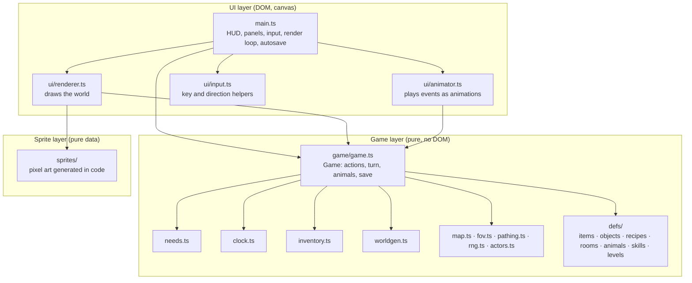
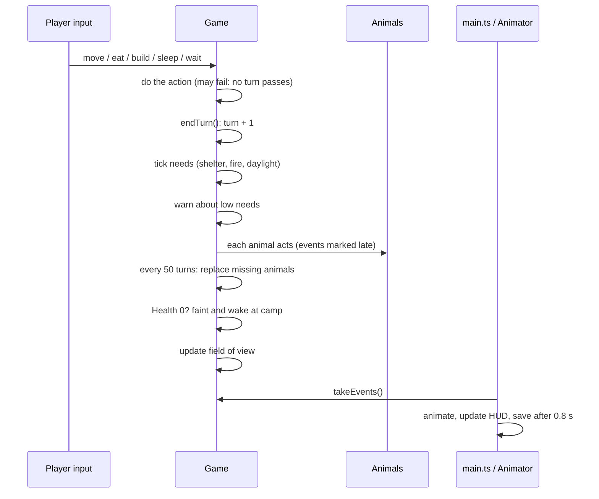

# pwagame overview

This document describes how the game is built and how its mechanics work.
Read it before you change the code or add content. The numbers here are the
values in the code at the time of writing; the code is the source of truth.

Contents:

1. [What the game is](#1-what-the-game-is)
2. [Architecture](#2-architecture)
3. [The turn](#3-the-turn)
4. [Mechanics](#4-mechanics)
5. [The world](#5-the-world)
6. [Content registries](#6-content-registries)
7. [Sprites and rendering](#7-sprites-and-rendering)
8. [Input](#8-input)
9. [Saving](#9-saving)
10. [Tests](#10-tests)
11. [Tuning reference](#11-tuning-reference)
12. [Known limits](#12-known-limits)
13. [Languages](#13-languages)

---

## 1. What the game is

A turn-based survival game for children, played on a phone in the browser
(a PWA). The player washes up on an island and must keep five needs filled:
Health, Food, Water, Energy and Warmth. The player gathers food and
materials, builds shelters and gets through the nights.

Design rules:

- **No death.** When Health is zero, the player faints and wakes up at camp
  the next morning with all items.
- **No fighting.** Animals can be a nuisance. They cannot be hurt. Walking
  into an animal shoos it away.
- **Short, readable feedback.** Every action gives a log message, and most
  give a floating text or an animation.
- **Mobile first.** All actions work with taps. A keyboard also works.

There is no game engine and no runtime dependency. The code is TypeScript,
built with Vite. The sprites are generated in code (no image files).

---

## 2. Architecture

The code has three layers. Each layer only depends on the layers below it.



### Responsibilities

| Module | Responsibility |
|---|---|
| `src/game/game.ts` | The `Game` class. Holds all state. Runs actions and the turn. Sends events. Saves and loads. |
| `src/game/defs/*.ts` | Data registries for items, world objects, recipes, hut rooms, animals, skills and levels (island goals). |
| `src/game/needs.ts` | The five needs and how one turn changes them. |
| `src/game/clock.ts` | Time of day, daylight, day and night phases. |
| `src/game/inventory.ts` | What the player carries (a count per item). |
| `src/game/worldgen.ts` | Makes a new island: terrain, caves, objects. |
| `src/game/riggen.ts` | Makes the oil rig of level 4: platforms, gangways (some broken), the helipad and what stands on the decks (see §5). |
| `src/game/caves.ts` | Finds the deep caves (big caves with few ways in) from the tiles (see 4.18). |
| `src/game/map.ts` | The tile grid, plus the "explored" and "visible" layers. |
| `src/game/fov.ts` | Field of view (recursive shadowcasting). |
| `src/game/pathing.ts` | Breadth-first distance maps (8 directions). |
| `src/game/rng.ts` | Seeded random numbers (mulberry32). Its state can be saved. |
| `src/game/actors.ts` | The `Player` and `Animal` shapes and facing helpers. |
| `src/ui/renderer.ts` | Draws terrain, objects, animals, the player, night light and effects on a canvas. |
| `src/ui/animator.ts` | Turns game events into timed animations. |
| `src/ui/input.ts` | Maps keys to commands. Finds a direction from a touch point. |
| `src/ui/mapview.ts` | Draws the Cartographer's map of the explored island as one sprite (see 4.15). |
| `src/main.ts` | Connects everything: HUD, Bag, Build, Skills, Hut and Map panels, the grill button above the campfire, the island goal card, the sail question and end screen, touch and keys, render loop, autosave, language switch. |
| `src/game/messages.ts` | The `Msg` type: every log message as data (a key and its arguments). |
| `src/i18n/*.ts` | All text the player sees, in English (`en.ts`) and German (`de.ts`). |
| `src/sprites/*.ts` | All pixel art, made in code from a shared palette. |

### Key rule: the game layer has no DOM

`src/game/` must not use `document`, `window` or the canvas. This keeps all
rules testable with Vitest in Node. The UI reads the game state and calls
game actions. The game tells the UI what happened through **events**.

### Events

Each action can send events. The UI collects them with `game.takeEvents()`
after each action and gives them to the animator.

| Event | Meaning | Animation |
|---|---|---|
| `move` | An actor moved one cell | Slide between cells, walk frames |
| `lunge` | An actor reached towards a cell (gather, shoo, pinch, build, cook at the fire) | Short push towards the target |
| `cast` | The explorer cast the fishing rod towards a sea cell | Fishing pose for 0.7 s (also with reduced motion) |
| `hit` | An actor lost Health | White flash and a red number |
| `float` | Show a number at a cell (`+2 wood`, `+35 water`, `+1 XP`): `amount` and `what` (an item, a need or XP) | Text rises and fades. XP has its own colour (lavender). |
| `sparkle` | Something good happened at a cell (chest, building, skill point, skill learned) | Gold sparkles |
| `fade` | Time jumped (sleep, faint, new island, sailing to island 2) | Screen fades in from dark |

Each event has a `late` flag. `late` is true for events from the animals'
part of the turn. The animator starts late events 90 ms after the player's
events, so the player sees cause before effect.

---

## 3. The turn

The game is turn-based. Time only moves when the player acts. One turn is six
minutes of game time.



### Actions

All actions return `true` when time passed and `false` when nothing happened.

| Action | What it does |
|---|---|
| `move(dx, dy)` | Steps one cell. If something is there, it interacts instead (see below). |
| `travelStep(x, y)` | One step on the shortest known path to a cell. Used for tap-to-travel. |
| `wait()` | Passes one turn. |
| `eat(item)` | Eats one food item from the bag. |
| `feedDog(item)` | Gives the dog one food item from the bag (see 4.13). |
| `build(recipe)` | Builds in front of the player, or makes an item for the bag. |
| `learn(skill)` | Spends skill points on a skill. No turn passes. |
| `sail()` | Leaves the island on the finished goal (see 4.12). |
| `sleep()` | Sleeps for many turns until a stop condition (see 4.4). |
| `addRoom(room)` | Adds a room to the hut the player stands in (see 4.19). |
| `drinkBarrel()` | Drinks at the rain barrel of the hut the player stands in (see 4.19). |

What `move` does when the target cell is not free:

1. **Animal there:** shoo it. The animal runs away for 8 turns (calm animals do not run).
   The stray dog is different: the player adopts it (see 4.13).
   **Your dog there:** swap places with it.
2. **Solid object there:** interact with it:
   - Spring: drink.
   - The island goal (the boat): give it materials (see 4.12).
   - Steep step (rocky step, ice wall): say that it is too steep and what to
     build on it (`tooSteep`, see 4.14). No turn passes.
   - Object with `gather`: gather from it. If it `needs` a tool that the
     player does not carry (bramble: axe), say so. No turn passes.
   - Other object: show its name. No turn passes.
3. **River** (with no bridge): drink, +35 Water.
4. **Sandbar under water** (high tide): say when the next low tide starts
   (`tideHigh`, see 4.16). No turn passes.
5. **Sea:** with a fishing rod in the bag, fish (see 4.11). Else show "too
   salty". No turn passes.
6. **Rock:** nothing happens. No turn passes.

---

## 4. Mechanics

### 4.1 Needs

All needs go from 0 to 100. A new game starts with Health 100, Food 80,
Water 80, Energy 90 and Warmth 100.

Change per turn:

| Need | Awake | Asleep |
|---|---|---|
| Food | −0.45 | −0.225 |
| Water | −0.45 (up to ×1.5 on hot ash, see below) | −0.225 |
| Energy | −0.25 | +1.4 × (0.4 + 0.6 × shelter) |
| Warmth | moves towards a target (see 4.3): +1.5 up, −0.6 down | same |
| Health | −1 for each empty need (Food, Water, Energy, Warmth) | same |
| Health | +0.25 if no need is empty and Food and Water are above 50 | +0.5; in a hut bed +1, with a hearth +1.5 (see 4.4) |

What this means in play (awake, no food or drink):

- Water goes from 80 to 0 in about 180 turns (three quarters of a day).
- Food goes from 80 to 0 in about 180 turns. A day uses about 108 Food:
  11 coconuts, or less than 3 cooked fish.
- Health from animals comes back only while Food and Water are above 50. So
  an explorer who eats badly stays hurt.
- Energy goes from 90 to 0 in about 360 turns (one and a half days).

**Hot ash (island 3).** On `Ash`, Water drops faster: the rate is × (1 +
`heat` × (1 − shelter)), with `heat` = 0.5 × daylight (`ASH_HEAT`). So open
ash at midday uses 0.675 Water a turn; at night, in a hut or off the ash it
is the normal rate. Stepping onto ash in the day (daylight above 0.5) logs
`ashHot`.

**Warnings.** When a need goes below 25 (`LOW`), the log shows a warning one
time. The warning resets when the need is above 35 again. The HUD bar of a
low need pulses. The Water warning gives a tip for the island: a spring or a
coconut on island 1, a spring or the river on island 2 (no coconuts there),
a spring, a hot spring or a coconut on island 3, and a rain water tank on
the oil rig (island 4). The `low` message carries the `level` for this.

### 4.2 Fainting (no death)

When Health is 0 at the end of a turn:

1. The log says the player feels woozy.
2. Time jumps to the next 6:00.
3. The player moves to **home** (the camp).
4. Needs become: Health 50, Food at least 25, Water at least 30, Energy 70,
   Warmth 80.
5. All items stay in the bag.
6. The log gives a hint (`faintWhy`): which needs ran out, with a tip for
   each. If no need was empty, wild animals did it.
7. The count for the star "Safe and sound" starts again (`safeSince`, see
   4.17).

**Home** is the last shelter or cave where the player slept. At the start,
home is the start point on the beach.

### 4.3 Warmth, shelter and fire

Warmth moves towards a target value each turn:

- Near a campfire (2 cells or less) or a hot spring (1 cell, `warmthRadius`
  1): target 100.
- Else: target = 100 − (1 − shelter) × ((1 − daylight) × 95 + cold), at
  least 0. `cold` is 40 on snow (`SNOW_CHILL`, island 2) and 0 elsewhere. So
  open snow has a target of 60 by day and 0 at night. A hut or a campfire
  still gives 100. Stepping onto snow logs `snowCold`.

Shelter values:

| Place | Shelter | Night warmth target |
|---|---|---|
| Open ground | 0 | 5 |
| Cave floor | 0.5 | about 52 |
| Lean-to | 0.6 | 62 |
| Hut | 1 | 100 |
| Next to a campfire | (any) | 100 |

### 4.4 Sleep

The player can sleep when Energy is below 95 and below the rest limit of the
place. **Only the bed in the hut (the camp) gives a full rest.** The rest
limit (`restCap()`) is the most Energy a sleep there gives:

| Place | Rest limit |
|---|---|
| Open ground | 50 (`OPEN_REST`) |
| Cave floor | 60 (`CAVE_REST`) |
| Lean-to | 75 (`rest` of the object) |
| Hut (its bed) | 100 |

At or above the limit, `sleep()` logs `restLimit` and no turn passes.

In a hut, Health also comes back faster while asleep: ×2 (`BED_HEAL`, +1 per
turn), ×3 with a hearth (`HEARTH_HEAL`, +1.5 per turn). The `heal` condition
in `needs.ts` does this.

Sleep repeats turns until one of these occurs:

- Energy reaches the rest limit below 100 (`restless`: "You wake up, but not
  fully rested").
- Energy is 100 ("You wake up feeling rested").
- Warmth is below 12 ("Too cold to sleep").
- Food or Water is 0.
- 200 turns have passed.
- The player faints.

When the player sleeps in a shelter or a cave, that cell becomes home.

Time to sleep from Energy 20 to the rest limit:

| Place | Turns | Game hours |
|---|---|---|
| Open ground (to 50) | about 54 | 5.4 (the cold often wakes the player first) |
| Cave (to 60) | about 41 | 4.1 |
| Lean-to (to 75) | about 52 | 5.2 |
| Hut (to 100) | about 57 | 5.7 |

The UI does not animate each turn of sleep. It shows one `fade` event.

### 4.5 Day and night

- One day is 240 turns. One turn is 6 minutes. A new game starts at 8:00 on day 1.
- Phases: dawn 5:00–7:00, day 7:00–19:00, dusk 19:00–21:00, night 21:00–5:00.
- Daylight is 1 in the day, 0 at night, and changes smoothly at dawn and dusk.
- The view distance is 4 + 4 × daylight cells (8 by day, 4 at night). Night
  eyes and the crystal lantern each add up to 2 cells, × (1 − daylight).
- **Deep caves are dark** (see 4.18): `daylightAt(x, y)` is 0 on their floor
  and on the rock round them. The view distance uses the daylight of the
  player's cell, so in a deep cave it is 4 (6 with the lantern), also by day.
- The renderer darkens each cell by `daylightAt()`. Campfires light 5 cells
  around them, glowcaps 1 cell (not while they regrow). The player always
  lights a small area around themselves, a larger one with the lantern.
- **Tide** (`isLowTide()` in `clock.ts`): low tide from 5:00 to 11:00 and
  from 17:00 to 23:00, high tide the rest of the time. Only the sandbar to
  the tide islet cares (see 4.16).
- **Cave bears** sleep from 7:00 to 19:00 (the `day` phase, see 4.9).

### 4.6 Gathering

Walking into an object with `gather` gives items. Each yield has a random
amount (min to max) and can have a chance. After gathering, one of three
things happens:

| `after` | Effect | Examples |
|---|---|---|
| `{ regrow: n }` | The object stays. It gives items again after n turns. It shows its `depletedSprite` until then. | palms, trees, bushes, berry bushes |
| `{ remove: true }` | The object is gone. | logs, driftwood, pebbles, mushrooms |
| `{ becomes: kind }` | The object turns into another object. | closed chest → open chest |

Two optional fields use tools:

- `needs: item` (on the gather): the player must carry this item to gather
  at all. A bramble needs the axe. Brambles are removed and never come back.
- `tool: item` (on a yield): this yield drops only when the player carries
  the tool. Yields of the same item add up.

**Wood and logs.** Every tree that gives wood (broadleaf, pine, spruce, snowy
spruce, birch) uses `TREE_WOOD` in `objects.ts`:

| | Wood | Logs |
|---|---|---|
| By hand | 1 | none |
| With the axe | 1–2 | 1–2 |

Logs come only from trees, and only with the axe. Fallen logs, log piles,
driftwood and chests give wood, also with the axe. The hut, the bridge, the
boat hull and mast, and the beacon wood pile need logs (see 4.8 and 4.12).
The campfire, the lean-to and the axe need only wood, so the first camp
and the axe are possible by hand.

The gather message tells what happened (`gather` in `messages.ts`):

- `used`: a tool yield was possible. The text is "You chop at the pine
  tree" instead of the object's gather text.
- `lack: { tool, item }`: a tool yield of a new item was skipped. The text
  adds a hint ("With a stone axe you could also chop logs"). There is no
  hint for more of an item the player already gets.

Tools (`tool: true` on the item) stay in the bag. They are never used up.

### 4.7 Eating and drinking

- **Eat** from the Bag panel. Each food adds to Food, Water and/or Energy.
  The player cannot eat when Food is 98 or more, unless the food also gives Water.
- **Drink** by walking into a spring, a hot spring or the river: +35 Water.
  Not possible when Water is 98 or more. A hot spring logs `drink` with
  `warm`.
- The sea cannot be used for drinking.

### 4.8 Building

The Build panel lists all recipes. A recipe needs items. The building goes:

1. In front of the player (the facing direction), if the cell is free floor.
2. Else in the first free neighbour cell.

A solid building (for example a campfire) is not placed where it would cut
off part of the island. This check counts brambles as open and rivers as
crossable (as if every bramble were cleared and every bridge built).
Shelters (`walkable`) can be placed anywhere free, and the player can walk
into them.

Only one hut can stand on each island (the camp): with a hut on the island,
`buildProblem('hut')` is `oneHut`. The Build panel shows that note, and before
the Cartographer skill it says that a map of the island hangs on the hut wall
with that skill (`hutMapRemark`).

Special recipes:

- **Items** (`makes` instead of `builds`): the item goes into the bag. A
  tool cannot be made when the player already has one (`haveTool`).
- **Skill** (`skill`): the recipe needs a skill (fishing rod). The Build
  panel shows the recipe with a note until the skill is learned.
- **At the fire** (`atFire`): the player must be within a campfire's warmth
  (2 cells). Cooking fish works this way, with the message `cook`.
- **Handy builder:** with this skill, a recipe that needs wood costs 1 wood
  less. `game.recipeCost(id)` gives the cost after skills. Always use it,
  not `RECIPES[id].cost`.
- **Bridge** (an object with `bridge: true`): it goes straight ahead, in the
  facing direction. The cells in front must be river, 1 to 3 cells
  (`BRIDGE_SPAN`), with free ground after them. The bridge fills all those
  cells. Facing left or right builds `bridge_ew`, else `bridge_ns`. If
  there is no such river, the message is `noBridgeSpot`.
- **Stepping stones** (island 3, `lava_stones`, 8 stone): a bridge with
  `onLava`. It works the same, but over lava cells (`lava_stones_ew` or
  `lava_stones_ns`). With no lava ahead, the message is `noLavaSpot`. A
  bridge does not go over lava, and stepping stones do not go over a river.
- **On a step** (a recipe with `onto`, a list of kinds): the building
  replaces that object. It goes on such an object in front of the player,
  else on the nearest one next to the player. If there is none, the message
  is `noStep` with the first kind of the list (see 4.14).
- **Mend gangway** (island 4, `gangway`, 6 scrap): a recipe with `onto` the
  four broken gangway ends (`gangway_end_n/s/e/w`, which have `broken`).
  It mends the whole gap: every broken end in a row along the gangway
  (`brokenRun()`) becomes `gangway_ns` or `gangway_ew`, and the message is
  `gangwayMended`. Walking into a broken end logs `gangwayBroken`; no turn
  passes.

### 4.9 Animals

Animals have a **temper**. They only react when the player is within their
`notice` range and in view.

| Temper | Behaviour when the player is near | Animals |
|---|---|---|
| `calm` | Ignores the player. | turtle |
| `shy` | Moves away from the player. | piglet, bat, rabbit |
| `grumpy` | If next to the player: `hitChance` (default 50%) per turn to hurt (−`damage` Health), then runs away for `fleeAfter` turns (default 4). A `nocturnal` one also follows the player (see below). | crab (−4), snake (70%, −8), cave bear (50%, −20, runs off for 10 turns) |
| `cheeky` | If the player carries food: comes near and takes one food item, then runs away for 12 turns. It does not take food that the goal's current stage still needs (for example the coconuts and cooked fish for the boat supplies), only the extra food. | monkey, squirrel |
| `stray` | Stays near its place (`notice` 0). Walking into it with food adopts it (see 4.13). | stray dog |
| `charger` | Runs at the player, 2 cells per turn (`CHARGE_STEPS`), with the message `alert`. When it starts a turn next to the player, it knocks them over (−`damage` Health), then trots off for 10 turns. | wild boar (−12), mountain goat (−10) |
| `chaser` | Follows the player for 6 turns (`CHASE_TURNS`, stored as `chase` on the animal) and stings each turn it is next to them (−3 Health). It gives up at once when the player stands off its habitat (sand, cave, shelter). Then it flies off for 8 turns. | wasps |

**Sleeping cave bears.** The cave bear is `nocturnal`. `game.asleep(a)` is
true from 7:00 to 19:00 (the `day` phase), unless the bear runs away (`flee`)
or follows the player (`chase`). A sleeping bear does not move, notice the
player or hurt them, Wild sense marks nothing round it, and the renderer
draws `animal_bear_sleep` (with a "z", no idle bob). Walking into it shoos
it as usual: it wakes, runs off for 8 turns, then sleeps again.

Awake (19:00 to 7:00), a bear notices the player from 3 cells. When it is
not next to the player, it logs `alert` and **prowls**: it follows the
player for 5 turns (`PROWL_TURNS`, stored in `chase`), one cell a turn,
with the wasps' chase rules. It stops at once when the player is off cave
floor or in a shelter. When it is next to the player, it swipes with its
`hitChance`; one swipe ends the prowl. After a prowl it runs off for 10
turns (`fleeAfter`). The player walks as fast as a bear, so walking away
always works. Wild sense marks its full notice range while it is awake.

**Islands.** `islands` lists the islands (levels) where an animal lives
(default `[1]`). `islandAnimals(level)` gives the list. Island 1: crab,
turtle, monkey, piglet, bat, boar, snake, wasps, bear. Island 2: crab, bat,
boar, wasps, bear, rabbit, squirrel, mountain goat. Island 3: crab, turtle,
monkey, bat, boar, snake, wasps, lizard (shy, ash and sand), gull (cheeky,
sand), scorpion (grumpy and wild, ash and caves: 50%, −6). No cave bears.
Island 4, the oil rig: only gulls (also on `Deck`). No wild animals and no
stray dog.

**Wild animals** (`wild: true`: boar, snake, wasps, cave bear, mountain goat, scorpion) only appear
at least `minHomeDistance` (25) cells from home. A new hurt message is
`hurt`, with a text for each animal in `src/i18n/`. Crabs keep `pinch`.

Other rules:

- Animals only walk on their `habitat` tiles. They never enter objects or the player's cell.
  Exception: a `climber` (the mountain goat) also walks on steep steps and
  on the ladders and ropes on them. It finds the way to the player over
  steps (`climberDist`).
  No habitat has river tiles, so animals never cross the river, also not on bridges.
- When they do not react, they wander (chance per turn = `wander`).
- Shooed animals run away for 8 turns.
- Animals do not act on the player while the player sleeps. Sleep also ends a wasp chase.
- `game.noticeRange(kind)` gives the notice range after skills.
- Every 50 turns, the game adds one animal of each kind that is below its
  `population`, out of the player's view.

### 4.10 Experience and skills

The player gets XP (experience):

| Action | XP |
|---|---|
| Gather from an object | 1 |
| Build or make a recipe | 1 for each item in its cost (campfire 5, hut 94, cook a fish 1) |
| Add a room to the hut | 1 for each item in its cost (workshop 20, hearth 16, rain barrel 11) |
| Catch a fish | 2 |
| Give an item to the island goal (the boat) | 1 for each item |

Each XP gain sends a `float` event (`what: { xp: true }`) next to the other
floating text.

**Skill points.** The first point needs 10 XP. Each next point needs 5 XP
more than the one before: 10, 25, 45, 70, 100 XP in total
(`xpForPoints`, `pointsForXp` in `skills.ts`). Points are not stored: free
points = points earned from XP − cost of the learned skills. When a point is
earned, the log says so (`skillPoint`) and the player sparkles.

**Skills.** Three paths: Building (skills to build things), Explorer (skills
that change the explorer) and Improving (skills that make things work
better). In a path, a skill needs the skill before it. The first two skills
on a path cost 1 point, the third and later ones cost 2.

| Path | Skill | Effect | Where |
|---|---|---|---|
| Building | Fishing rod | Unlocks the fishing rod recipe | `recipes.ts` (`skill`) |
| | Handy builder | Recipes cost 1 wood less | `Game.recipeCost()` |
| | Rope maker | The rope recipe makes 2 rope, not 1. The Build panel shows "Rope ×2". | `Game.recipeMakes()` |
| | Cartographer | In a hut, a map of the explored island hangs on the wall (see 4.15) | `Game.canReadMap()`, `mapview.ts` |
| | Pack frame | Unlocks the pack frame recipe (a tool: +15 load, see 4.21) | `recipes.ts` (`skill`), `Game.loadLimit` |
| Explorer | Small sips | Water drops 20% slower | `needs.ts` (`thirst`) |
| | Small appetite | Food drops 20% slower | `needs.ts` (`hunger`) |
| | Thick skin | Warmth drops 30% slower | `needs.ts` (`chill`) |
| | Night eyes | Up to 2 more cells of sight at night | `Game.sightRadius` |
| | Sure foot | A climb onto a ladder or a rope costs no Energy (see 4.14) | `Game.climb()` |
| | Strong back | The bag holds 10 more heavy things (see 4.21) | `Game.loadLimit` |
| Improving | Green thumb | Plants regrow in 70% of the time | `Game.interact()` |
| | Patient angler | Bite chance 40% → 70% | `Game.fish()` |
| | Animal friend | Crabs do not pinch, monkeys do not take food. Wild animals notice the player 2 cells later (at least 1) | `Game.noticeRange()`, `Game.animalAct()` |
| | Wild sense | A red tint with a red border marks the cells where a visible animal would come after the player or hurt them | `Game.dangerCells()`, `renderer.ts` |

The Skills panel shows the free points, an XP bar to the next point, and each
path. The Skills button shows a star when there are free points.

### 4.11 Fishing and cooking

- Walking into the sea with a fishing rod in the bag casts the line (a
  `cast` event: the explorer shows the fishing pose). One turn passes.
- Chance of a bite: 40%, or 70% with Patient angler. A catch gives 1 raw fish
  and 2 XP. Else the log says "Nothing bites".
- The river is only for drinking. Fishing works only in the sea.
- Raw fish (`raw: true`) cannot be eaten. The recipe "Cook a fish" (1 fish,
  at a campfire) makes a cooked fish: +40 Food, +10 Energy. This is the best
  food on the island (coconut 10, berries 7, mushroom 9), so fishing is the
  way to stay well fed.
- **Grill button.** While the recipe can be made (raw fish in the bag, a
  campfire within 2 cells), `main.ts` shows a round button above the nearest
  visible fire (`game.nearestFire()`). It shows `ui_grill` / `ui_grill_2`
  (220 ms each), an ember glow and the number of raw fish. A tap (or the `g`
  key) runs `game.build('cooked_fish')`, and the icon shakes. The button
  follows the fire as the camera moves (`renderer.cellTop()`), and stays
  inside the map view. With reduced motion, the icon, glow and shake stay
  still. Cooking sends a `lunge` towards the fire.

### 4.12 The island goal (levels)

Each island is a **level** with one big goal: something the player builds
in stages to leave the island. `src/game/defs/levels.ts` (`LEVELS`) holds
each level's `biome` (how world generation shapes it, see §5), its goal
object (`site`) and its stages. Four levels exist: 1 (`tropical`), 2
(`mountain`), 3 (`volcano`) and 4 (`rig`, the oil rig). §4.20 describes each island and its goal as
a whole.

Level 1: an old boat wreck (`boat_wreck`) lies on a beach of the far side.

| Stage | Cost | The boat becomes |
|---|---|---|
| Hull | 12 logs, 6 wood, 6 stone, 4 tar | `boat_hull` |
| Mast | 4 logs, 2 wood, 6 rope | `boat_mast` |
| Sail | 12 leaves, 3 rope | `boat_sail` |
| Supplies | 4 coconuts, 3 cooked fish | `boat_ready` |

Rope is a recipe: 2 leaves make 1 rope. All stages together need 16 logs,
8 wood, 6 stone, 30 leaves, 4 tar, 4 coconuts and 3 cooked fish (about
eleven trees chopped with the axe, fishing, and a trip to the tide islet).

**Rare materials.** Tar (island 1) and resin (island 2) are items with
`rareFrom`: only these objects give them. Tar comes from the 3 old barrels
on the tide islet (`barrel`: 2 tar, then `barrel_empty`), 6 tar in all.
Resin comes from snowy spruces (50% chance of 1 with each gather); island 2
has at least 4 of them (`RESIN_TREES`). `game.stageCost(stage)` leaves a
rare material out when no object of its `rareFrom` is on the island: an
island 1 from before the tide islet does not need tar, an old island 2
without snowy spruces does not need resin. Always use `stageCost()`, not
`stage.cost`. The goal card shows a hint where to find a rare material
the stage still needs (`Strings.rareHints`).

How it works:

- When the boat first comes into view, the log says so (`goalFound`).
- Walking into the boat gives it everything from the bag that the current
  stage still needs. Each item floats as a minus number and gives 1 XP.
  `game.goalGiven` stores what the stage already got, so the player can
  bring things in many trips. If the bag has nothing it needs, the log
  lists what is missing (`goalNeeds`) and no turn passes.
- When a stage is complete, the object becomes the next kind, with
  sparkles. Objects with `goal: true` are goal objects; the stage is
  found from the kind (`goalProgress()`), so it is not stored separately.
- Walking into the finished goal sets a flag that the UI reads with
  `game.takeSailRequest()`. The UI asks the level's question ("Set sail?",
  "Light the beacon?"). `game.sail()` logs `sailAway` and sends a `fade`.
- **The boat trip.** Before the UI calls `sail()` on level 1, it plays the
  boat sailing away for 1.6 s (`DEPART_MS`): `boatTrip()` in `main.ts` picks
  the straight line from the boat with the fewest cells to the sea, and
  `renderer.departure` draws `boat_away_<body>` with the explorer on board
  while the camera follows it. Input is ignored during the trip. With
  reduced motion there is no trip, only the fade.
- **The balloon flight** (level 3) works the same way: `balloonTrip()`
  sends the balloon straight up for 10 cells, and the renderer draws
  `balloon_away_<body>` (2 frames for the flame). The beacon (level 2) has
  no trip.
- **On levels 1 to 3**, `sail()` then adds the level to `left` and lands the
  player on the next level (`landOn()`): the kept island if the player was
  there before (see 4.22), else a new island from `generateWorld(…, level)`, the player on
  its start point (also the new home), new animals for that island,
  `goalGiven` cleared, and the clock at 8:00 the next day. The bag, XP,
  skills and needs stay. The log says `sailAway`, then `landIsland` (with
  the new level). `sailed` stays false.
- **The crash.** After the balloon flight from island 3, the player lands
  on the oil rig (level 4), next to the crashed balloon
  (`balloon_crashed`), with `landIsland` level 4. On island 3 the balloon
  is gone: `done.frames` of `balloon_ready` is `balloon_gone` (two stakes),
  and `done.icon` (`balloon_ready`) is the picture on the goal card.
- **On the last level** (4), `sail()` sets `sailed`: the player called for
  help on the radio. There is no trip. The end screen says that help is on
  its way and that this is the end of the story for now. The player can
  stay on the rig or start a new island.
  `nextLevel(level)` gives the next level, or null on the last one.
- **Old saves** from when island 2 or island 3 was the last one can have
  `sailed` set on that level. They load with `sailed` false, so the lit
  beacon or the ready balloon asks again and takes the player on. (A `done` object with `lightRadius`
  keeps its look only while `sailed` is set.)
- `game.goal()` gives the state for the goal card at the top of the Build
  panel: `missing` (an old island without a boat), `find`, `build` (with
  the stage and what it still needs), `ready` or `sailed`. The words for
  each level are in `Strings.levels`.

Level 2 (Pine Ridge): an old stone ring (`beacon_site`) stands on the
highest snow of the mountain. The player builds a signal beacon on it.

| Stage | Cost | The beacon becomes |
|---|---|---|
| Stone base | 16 stone | `beacon_base` |
| Wood pile | 10 logs, 4 wood, 4 rope | `beacon_pyre` |
| Tinder | 12 leaves, 4 wood, 3 resin | `beacon_ready` |

All stages together need 10 logs, 8 wood, 16 stone, 20 leaves (8 of them
for rope) and 3 resin. There are no coconuts on island 2: apples, berries, mushrooms and
fish are the food there.

Level 3 (Ember Isle): an old hot-air balloon (`balloon_site`) lies on the
crater rim, on the highest ash. The player repairs it and flies home.

| Stage | Cost | The balloon becomes |
|---|---|---|
| Basket | 4 logs, 8 wood, 4 rope | `balloon_basket` |
| Balloon cloth | 16 leaves, 4 rope | `balloon_envelope` |
| Burner | 8 stone, 2 logs, 4 sulphur | `balloon_ready` |

All stages together need 6 logs, 8 wood, 8 stone, 32 leaves (16 of them for
rope) and 4 sulphur. **Sulphur** is the rare material of island 3: only
steam vents give it (`steam_vent`: 1–2 sulphur, regrows in 150 turns,
`steam_vent_spent` until then).

Level 4 (the oil rig): the old radio room (`radio_hut`) stands on the
platform furthest from the main deck, behind a broken gangway. The player
repairs it and calls for help.

| Stage | Cost | The radio room becomes |
|---|---|---|
| Aerial | 8 scrap, 2 rope | `radio_aerial` |
| Generator | 6 scrap, 4 diesel | `radio_power` |
| Radio | 4 scrap, 2 rope | `radio_ready` (2 frames: its light blinks; lights 2 cells) |

All stages together need 18 scrap, 4 rope and 4 diesel. **Diesel** is the
rare material of the rig: only the old fuel drums give it (`diesel_drums`:
2 diesel, then `diesel_drums_empty`).

### 4.13 The dog

Each island has one stray dog (`dog`, temper `stray`, on grass, 25 or more
cells from camp) until the player has a dog.

- **Adopt.** Walk into the stray dog with food in the bag. It eats one
  item (raw fish first, else the food with the least Food) and becomes
  `game.dog`. Without food, the log says `dogSniff` and no turn passes.
  After that, no new stray dog appears.
- **Follow.** The dog acts first in the animals' part of the turn
  (`dogAct`). It steps towards the player when it is more than 1 cell away.
  More than 12 cells away (`DOG_LOST`), it jumps next to the player. It
  also comes along after fainting and to the next island
  (`dogToPlayer`). Walking into the dog swaps places with it. Animals and
  buildings cannot use its cell.
- **Bark.** When a visible animal with `scaredByDog` (crab, monkey,
  squirrel, snake) is within 3 cells (`DOG_BARK_RANGE`) and is not already
  running, the dog barks (`dogBark`, a `lunge`). All such animals within 3
  cells run away for 8 turns (`SHOO_TURNS`). Boars, goats, wasps and bears
  do not care.
- **Needs.** The dog has Food and Water (0 to 100). Each turn, Food drops
  0.3 and Water 0.35 (`DOG_HUNGER`, `DOG_THIRST`; half while the player
  sleeps). Below 25, the log warns one time (`dogLow`).
- **Food.** "Feed dog" in the Bag panel (`feedDog`) gives the item's Food
  value. Raw fish gives 30 (`DOG_RAW_FISH`). The dog must be within 2 cells
  (`DOG_REACH`), else `dogFar`. At 98 Food or more, `dogFull`.
- **Water.** The dog drinks (+50, `DOG_DRINK`) when the player drinks
  within 3 cells of it, and by itself when it stands next to a spring or
  the river with Water below 80.
- **Tired.** When Food or Water is 0, the dog is tired (`dogTired`). It
  trails behind every other turn, stays up to 2 cells away, does not bark
  and shows `dog_rest`. It never dies. When Food and Water are both above 0
  again, it is happy again (`dogBack`).
- **Sleep.** When the player sleeps, the dog comes next to the player
  (`dogToPlayer`) and lies down (`napping`, shows `dog_rest`). It gets up on
  the first turn after the player wakes. Saves from before have no
  `napping`; that means awake.
- The Bag panel shows a dog row with its Food and Water, and a "Feed dog"
  button on each item the dog can eat.

### 4.14 Steep steps (island 2)

On island 2, two rings of steep steps go round the peak (see §5). Every way
up to the beacon crosses both rings.

| Step (`steep`) | Where | Way up (recipe) | Cost | Becomes (`climb`) |
|---|---|---|---|---|
| Rocky step (`ledge`) | Outer ring, mostly scree | Ladder (`ladder`) | 4 wood, 2 rope | `ledge_ladder` |
| Ice wall (`ice_wall`) | Inner ring, mostly snow | Climbing rope (`climbing_rope`) | 1 wood, 4 rope | `ice_wall_rope` |

- Walking into a step logs `tooSteep` with the thing to build (`way`). No
  turn passes.
- The recipe has `onto`: it builds on such a step next to the player (see
  4.8). The ladder does not fit an ice wall. Building gives 1 XP per item
  (ladder 6, climbing rope 5). Handy builder makes them 1 wood cheaper.
  Rope maker halves the leaves for the rope (see 4.10).
- The ladder and the rope are walkable. Stepping onto one costs 2 Energy
  (`CLIMB_ENERGY`), with a float and the message `climb`. With Sure foot
  it costs nothing (`climb` with `easy`, no float). Stepping off is a
  normal step. The dog follows over them.
- Steps count as open for every "does this cut off the island" check
  (`canBeOpened()` in `objects.ts`, like brambles).
- The mountain goat (`climber`) walks over steps (see 4.9).
- Island 1 has no steps. Island 2 saves from before have no steps either.

### 4.15 The Cartographer's map

With the Cartographer skill (Building path, fourth, 2 points), the explorer
keeps a map on the wall of every hut. There is no map anywhere else.

- `game.canReadMap()` is true when the skill is learned and the player stands
  on a hut. Then the Hut panel (see 4.19) shows the map on the wall with a
  **Look** button, and the `m` key opens it. Without the skill the wall has an
  empty nail and a tip (`noMap`). Old logs can still have `mapHint`.
- The Map panel shows `drawMap()` from `src/ui/mapview.ts`: the explored cells
  as washes of colour on old paper. Unknown cells stay blank paper. The map is
  rough on purpose: each 2 × 2 block of cells (`MAP_BLOCK`) becomes one 3 × 3
  pixel patch with the most common ground of its explored cells. Ink lines
  mark the coast (land next to sea). The edge of what the explorer knows has
  no line, so it does not look like a shore.
- Signs (`map_<sign>` sprites, `MapSign`): where you are (`you`), huts,
  campfires, springs, the island goal once seen, each way into a deep cave
  once its cell is explored (`cave`, see 4.18), and bear areas. A list under
  the map names the signs that are on it. The panel draws the map at the
  largest whole-number scale that fits.
- **Bear areas.** After each sight update, `updateFov()` stores the cell of
  every visible cave bear in `game.bearSpots`, unless a stored cell is 6 cells
  or closer (`BEAR_SPOT_GAP`). So bears the explorer never saw are not on the
  map. The map shows a paw at each spot and red hatching on the known ground
  within 5 cells (`BEAR_AREA`). Landing on a new island clears the list.

---

### 4.16 The tide islet (island 1)

A new island 1 has a small islet off a beach of the wild forest (else the far
side, else the home coast), joined to it by a straight **sandbar** of 2 to 5
sea cells (see §5).

- The sandbar is objects on sea cells (`sandbar_ns`, `sandbar_ew`, with
  `tidal` and `walkable`). `isPassable()` is true on them only at low tide
  (see 4.5). At high tide `objectSprite()` gives `<kind>_wet`: a light strip
  of shallow water.
- Walking into the sandbar at high tide logs `tideHigh` with the turn the
  next low tide starts (`nextLowTide()`). No turn passes, also with a
  fishing rod.
- When the tide turns, the log says so (`tideOut`, `tideIn`), but only
  once the explorer has seen a sandbar cell (`game.tideKnown()`) and is
  awake. The HUD clock line then also shows "low tide" or "high tide".
- **The water comes in.** When high tide starts while the explorer stands
  on the sandbar, they move to the nearest dry cell along it (a `move`
  event), lose 15 Warmth (`WADE_CHILL`) and the log says `tideWade`. A dog
  on the sandbar comes next to the explorer. On the islet, the explorer
  waits for the next low tide (at most 6 hours); its palm gives coconuts.
- On the islet: 3 old tar barrels, a palm and a chest.
- Every "does this cut off the island" check counts the sandbar as open
  (`canBeOpened()`). Animals never go on it (their habitats have no sea).
- **Old islands.** An island 1 without a sandbar (`game.oldIsland`, from a
  save before version 8) works as before: its hull needs no tar. The goal
  card says that a new island 1 has the tide islet, with the button "New
  island, keep progress" (tap two times). `Game.newIslandKeeping(old)`
  makes a new island 1 and keeps the bag, XP, skills, stars and the dog
  (with a new id, next to the explorer, and no stray dog on the island).
  Needs, goal progress and the clock start again.

### 4.17 Island stars

Each island has three optional tasks (`stars` in `LEVELS`). They never block
the goal.

| Star | Islands | Task | Progress |
|---|---|---|---|
| `chests` (Treasure hunter) | 1, 2, 3 | Open every chest on the island (also the islet chest) | open / all chests |
| `fish` (Angler) | 1, 3 | Catch 5 fish on this island (`STAR_FISH`) | `fishHere` |
| `explore` (Explorer) | 2, 3 | Explore 75% of the floor (`STAR_EXPLORE`) | percent |
| `safe` (Safe and sound) | 1, 2 | 3 days in a row without fainting (`STAR_SAFE_DAYS`) | whole days since `safeSince` |

- `checkStars()` runs at the end of every turn and when the player sails. A
  new star is stored in `game.stars` as `[level, star]`, logs `star`, makes
  the explorer sparkle and gives 5 XP (`STAR_XP`).
- Fainting sets `safeSince` to the morning after. Landing on a new island
  sets it to the landing turn and `fishHere` to 0. So every star can still
  be earned after a setback.
- `game.starStates()` gives each star of the island with `done`, `have` and
  `need`. The Build panel shows them in a card under the goal card: a gold
  `ui_star` when earned, else a grey `ui_star_empty` and the progress. The
  end screen shows all stars earned ("Stars: 4 of 9").

### 4.18 Deep caves

Every new island has big caves dug into its hills: 3 on island 1, 2 on
island 2 (`DEEP_CAVES`). Each has 45 to 80 cells of winding cave floor, a
wall of rock all round, and one way in (see §5).

- **What is a deep cave.** `findCaves()` in `caves.ts` finds them from the
  tiles: each 8-way connected patch of cave floor with at least 30 cells
  (`DEEP_CAVE_CELLS`) and at most 4 ways in (`MAX_WAYS_IN`). A way in is a
  cave cell next to open ground; ways in 3 cells apart or closer count as
  one. If the river cuts a cave off from open ground (a bridge leads in),
  the cells by the river are its ways in. The save stores nothing for
  caves. `game.caves()` keeps them for the current map.
- **Dark.** `game.inCave(x, y)` is true on the floor of a deep cave. There,
  and on the rock round it, there is no daylight (see 4.5). Walking in from
  outside logs `caveEnter` (with `lantern` when the explorer carries it).
  Warmth does not change: caves still give 0.5 shelter.
- **What grows there.** Each deep cave gets a chest at the cell furthest
  from its way in, 3–5 glowcap clumps (`CAVE_GLOWCAPS`) and 2–4 crystal
  clusters (`CAVE_CRYSTALS`), plus the normal cave scatter. Glowcaps and
  crystals grow nowhere else (`CAVE_OBJECTS`).

| Thing | Gives | After |
|---|---|---|
| Glowcap clump (`glowcap`) | 2–3 glowcaps | Regrows in 160 turns; shows `glowcap_picked` and does not glow until then |
| Crystal cluster (`crystal_cluster`) | 1–2 crystals | Removed |

- **Glowcap** (food): 6 Food, 4 Water, 15 Energy. The only food that gives
  much Energy.
- **Crystal lantern** (`lantern`, a tool): 3 crystals, 1 wood, 1 rope. It
  adds 2 cells of sight at night and in deep caves (`LANTERN_SIGHT`), and
  the renderer lights more round the explorer (`LANTERN_LIGHT`).
- **The map.** With Cartographer, the map shows a cave sign at each way in
  the explorer has seen (see 4.15).
- **Old islands.** Islands from before have no dug caves. A patch of their
  cave floor can still count as a deep cave (dark, on the map), with no
  glowcaps or crystals.

### 4.19 The camp: the hut and its rooms

The hut is the camp. It takes 24 logs, 12 wood, 30 leaves, 20 stone and 8 rope, and
each island has only one (see 4.8). It is the only place for a full rest and
heals faster (see 4.4).

- **The frame.** The hut is more than a bag can carry (see 4.21), so it is
  built in trips. The `hut` recipe costs nothing and places a `hut_site`
  (the frame; it has `site: 'hut'`). Walking into the frame gives it what
  the recipe's `siteCost` still needs (`Game.workOnSite()`; Handy builder
  makes it 1 wood less, `Game.siteCost()`), 1 XP for each item, with
  `siteGive` or `siteNeeds`. The frame keeps what it got in `given`. When
  it has everything, it becomes the hut, with sparkles and `siteDone`. The
  one-hut rule counts the frame too. The Build panel shows what the frame
  still needs (`Game.siteLeft()`).

- **Inside.** Walking into a hut logs `enterHut` and sets a flag that the UI
  reads with `game.takeHutRequest()`: `main.ts` opens the **Hut panel**. While
  the player stands in a hut, the **Hut** button (between Skills and Sleep)
  and the `e` key open it again. `game.hutHere()` gives the hut. A walk
  (tap-to-travel, hold) stops when the panel opens.
- **The Hut panel** shows the rooms side by side as one picture
  (`room_main` or `room_main_map`, then each room), at the largest whole
  scale that fits; the hearth flickers (not with reduced motion). Under it:
  the bed (Sleep), the map (Look, or the empty nail), one row for each room,
  and "Add a room" with each missing room, its cost and a Build button.
- **Rooms** (`ROOMS` in `src/game/defs/rooms.ts`). A hut keeps its rooms in
  `rooms` on its `WorldObject`. `game.addRoom(id)` needs the player in the
  hut and the materials (`roomCost()`, with Handy builder 1 wood less), and
  gives 1 XP for each item, with sparkles and `roomBuilt`.

| Room | Cost | Effect | Where |
|---|---|---|---|
| Workshop (`workshop`) | 12 wood, 6 stone, 2 rope | The rope recipe in this hut makes 1 more (`WORKSHOP_ROPE`): 2, or 3 with Rope maker | `Game.recipeMakes()` |
| Hearth (`hearth`) | 12 stone, 4 wood | A fire on the hut's own cell: cook fish there (the grill button too), light 2 cells at night (`HEARTH_LIGHT`), heal ×3 asleep | `Game.nearestFire()`, `lights()`, `endTurn()` |
| Rain barrel (`barrel`) | 8 wood, 3 rope | Drink at home: +35 Water (`BARREL_DRINK`) | `Game.drinkBarrel()` |

- **Outside**, the hut sprite shows its rooms: `hutSprite(rooms, frame)` in
  `rooms.ts` gives `hut`, `hut_workshop`, `hut_workshop_hearth_barrel`… The
  workshop is a bench under an awning on the left, the hearth a chimney with
  smoke (2 frames, `…_2`), the rain barrel stands at the front right.
  `game.objectSprite(obj, frame)` picks the name; the renderer passes its
  fire frame.
- The HUD line in a hut says "In your hut" (also with a hearth).

### 4.21 The carry limit and the store crate

The bag holds only so many **heavy** things (`heavy: true` on the item):
wood, logs, stone, scrap and diesel, 1 load each. Everything else (food,
leaves, rope, tools, tar, resin, sulphur, crystals) has no load.

- `game.load` is the load in the bag. `game.loadLimit` is 30 (`BAG_LOAD`),
  +10 with Strong back (`STRONG_BACK_LOAD`), +15 while the pack frame is in
  the bag (`PACK_FRAME_LOAD`): 55 with both.
- **A full bag.** When the load is at the limit or more, gathering from an
  object that would give a heavy item (with the tools the player carries)
  logs `tooHeavy`, and no turn passes. One gather can still go a little over
  the limit. Light things can always be gathered. Chests use the same rule.
- Saves from before keep everything in the bag, also over the limit; only
  gathering waits until the load is lower. The cheats ignore the limit.
- **The store crate** (`store_crate`, 6 wood and 2 rope, one on each
  island, else `oneStore`) has `store: true`. Walking into it logs
  `openStore` and sets a flag that the UI reads with
  `game.takeStoreRequest()`: the **Store panel** opens. No turn passes.
  The panel shows the load, the bag and the crate (`WorldObject.store`),
  with "Put in 1", "Put in all", "Take 1" and "Take all". `game.storeItem()`
  and `game.takeItem()` need a store crate next to the player and take no
  time. Taking heavy things stops at the limit (`tooHeavy` when there is no
  room). The crate has no limit.
- **The pack frame** (`pack_frame`, a tool) is a recipe (4 wood, 3 rope)
  that needs the Pack frame skill (Building path, after Cartographer).
- The Bag panel shows a load row (`ui_load`) and marks heavy items.

### 4.22 The fishing boat and the kept islands

On the oil rig, an old fishing boat (`fishing_boat_wreck`) lies in the sea
at the south edge of the crew platform (else the main deck). With it, the
explorer sails between the rig and islands 1 to 3 to fetch what the rig
does not have.

- **Sites placed by the world.** An object can carry its own `siteCost` and
  `site` (the object it becomes): walking into it works like the hut frame
  (see 4.19). The fishing boat wreck takes 10 scrap, 6 wood and 4 rope and
  becomes `fishing_boat`. The derrick takes 12 scrap and 2 rope and becomes
  `derrick_working`: its pump gives 2 diesel, then refills in 120 turns
  (`derrick_idle` until then; 2 frames, its lamp blinks).
- **The sea chart.** Walking into the fishing boat (`boat: true`) logs
  `openChart` and sets a flag that the UI reads with
  `game.takeChartRequest()`. The panel lists the other islands (1, 2, 3 and
  the rig), says whether the explorer was there before
  (`game.visited()`), shows the hold, and has a Sail button for each.
- **A voyage** (`game.voyage(level)`, `voyageProblem()`: `noBoat`,
  `hereAlready`, `needDiesel`) burns 2 diesel (`VOYAGE_DIESEL`), from the
  hold first, then the bag, and takes 60 turns (`VOYAGE_TURNS`, 6 hours):
  needs go down as if awake in light shelter (0.6). The boat leaves its
  cell, the explorer lands, the boat moors on a free sea cell next to them
  (`moor()`): where it lay when they left that island, else the sea cell
  nearest to the island's home. Then `voyage` with the level. If Health ran
  out on the way, the explorer faints on arrival.
- **The cargo hold** (`game.hold`) goes with the boat. It carries 60 heavy
  things (`HOLD_LOAD`); light things do not count. `loadItem()` and
  `unloadItem()` need the boat next to the explorer and take no time
  (`holdFull` when the hold is full, `tooHeavy` when the bag is). The sea
  chart shows the hold and the bag like the Store panel.
- **Kept islands.** When the explorer leaves an island (on its goal or by
  boat), `landOn()` keeps it as it is (map, explored cells, objects, home,
  goal progress, bear spots, fish caught, and the boat's dock) in
  `islands`. Going there again brings it back; animals are made new. An
  island never visited is generated new.
- **Used goals.** `game.left` lists the islands the explorer left on their
  goal. `game.goalUsed` is true there, and on the last island after the
  radio call (`sailed`). A used goal shows its `done` look; the boat of
  island 1 sails off and is gone. Walking into a used goal only names it.

### 4.23 Supply drops and new platforms (the oil rig)

- **The Radio panel.** After the call for help (`sailed`), walking into the
  working radio (`radio_ready`) logs `openRadio` and sets a flag that the UI
  reads with `game.takeRadioRequest()`. `game.atRadio` is true next to it.
- **Orders** (`RADIO_ORDERS`, `game.order(id)`, no time passes): a food
  crate (3 cooked fish, 4 coconuts, 3 apples), a building crate (10 logs,
  6 wood, 12 leaves, 6 stone) or a fuel crate (4 diesel, 4 rope). One order
  each day (`orderDay`, else `orderedToday`), and one at a time (`onTheWay`).
- **Delivery.** 20 turns later (`DELIVERY_TURNS`), at the end of a turn on
  the rig, the helicopter drops a `supply_crate` on a free cell of the
  helipad (its middle if it can), with sparkles and `delivered`. While the
  explorer is away from the rig, the crate waits for them.
- **The supply crate** is a store (`store`, `dropped`): walking into it
  opens the Store panel. When it is empty, it is gone. It does not count as
  the island's store crate.
- **New platforms.** The `platform` recipe (6 scrap, 2 wood) builds
  `platform_deck` (`deck: true`): no object, but the sea cell in front of
  the explorer becomes `Deck` (`map.change()`, which raises `map.version`, so
  the renderer draws the terrain again). The cell must touch the deck of the
  crew platform (joined to the crew cabin), be within 6 cells of the cabin
  (`PLATFORM_RANGE`), have no gangway (whole or broken) next to it, and no
  deck of another platform within 2 cells. Else `noDeckSpot`. So new decks
  give room at the camp, never a way past a broken gangway.
- **The rain tank** (`rain_tank`, 6 scrap) builds a `water_tank`.

### 4.20 The islands

This section brings together, for each island, what is on it and what its
goal is. The details are in the sections it links to. All islands are
104 × 80 cells and have the same three regions (home coast, wild forest,
far side), split by a bramble wall and a river (a lava flow on island 3)
(see §5). The explorer always starts on a beach of the home coast. The oil
rig (island 4) is different: it has no land at all (see below).

What islands 1 to 3 share:

- Springs, 2 or more of them on the home coast.
- 8 chests in the open (2 home coast, 3 wild forest, 3 far side) and one
  more at the far end of each deep cave.
- Deep caves with glowcaps, crystals and bats, and cave bears (see 4.18).
- One stray dog, far from camp, until the player has a dog (see 4.13).
- One hut (see 4.19).
- The Treasure hunter star (see 4.17).

| Island | Biome | Goal | Rare material | Stars |
|---|---|---|---|---|
| 1 | `tropical` | Repair the boat and sail away | Tar | Treasure hunter, Angler, Safe and sound |
| 2 Pine Ridge | `mountain` | Light a signal beacon on the peak | Resin | Treasure hunter, Explorer, Safe and sound |
| 3 Ember Isle | `volcano` | Repair the hot-air balloon and fly away | Sulphur | Treasure hunter, Angler, Explorer |
| 4 the oil rig | `rig` | Repair the radio and call for help | Diesel | Treasure hunter, Angler, Explorer |

#### Island 1: the tropical island (`tropical`)

| | |
|---|---|
| Land | Wide sandy beaches, a broadleaf and pine forest, rocky hills with caves, mostly on the far side |
| Trees and plants | Palms (tall, leaning, young), broadleaf and pine trees, bushes, berry bushes, mushrooms |
| Water | 8 springs and the river |
| Food | Coconuts, berries, mushrooms, fish, glowcaps (caves) |
| Animals | Crab, turtle, monkey, piglet, bat. Wild: boar, wasps, snake, cave bear |
| Deep caves | 3 |
| Chests | 12 (8 in the open, 1 on the tide islet, 3 in the deep caves) |
| Special place | The tide islet with its sandbar, dry only at low tide (5–11 and 17–23 o'clock) (see 4.16) |
| Rare material | Tar, 6 in all, from the 3 old barrels on the tide islet |
| Stars | Treasure hunter, Angler (catch 5 fish), Safe and sound |

**Goal: repair the boat and sail away.** An old boat wreck (`boat_wreck`)
lies on a beach of the far side. The player repairs it in four stages:

1. **Hull** (12 logs, 6 wood, 6 stone, 4 tar). Logs come from trees chopped
   with the stone axe. Tar comes from the tide islet.
2. **Mast** (4 logs, 2 wood, 6 rope).
3. **Sail** (12 leaves, 3 rope).
4. **Supplies** (4 coconuts, 3 cooked fish). The player needs the Fishing
   rod skill and a campfire.

The player must clear the brambles and bridge the river to reach the boat.
When the boat is ready, walking into it asks "Set sail?". The boat sails
away with the explorer, and the player lands on island 2. The bag, XP,
skills, stars, needs and the dog come along (see 4.12).

#### Island 2: Pine Ridge (`mountain`)

| | |
|---|---|
| Land | A narrow beach, a northern forest, and a mountain of cliffs and scree with snow on the peak |
| Trees and plants | Spruces, snowy spruces, birches, broadleaf trees, apple trees, ferns, bushes, berry bushes, mushrooms. No palms |
| Water | 8 springs and the river |
| Food | Apples, berries, mushrooms, fish, glowcaps (caves). No coconuts |
| Animals | Crab, rabbit, squirrel, bat. Wild: boar, wasps, mountain goat (climbs over steps), cave bear |
| Deep caves | 2 |
| Chests | 10 (8 in the open, 2 in the deep caves) |
| Cold | Open snow is cold also in the day: its warmth target is 60 by day and 0 at night (see 4.3) |
| Special places | Two rings of steep steps round the peak: rocky steps (ladder) and ice walls (climbing rope) (see 4.14) |
| Rare material | Resin, from snowy spruces (50% with each gather; at least 4 trees) |
| Stars | Treasure hunter, Explorer (explore 75% of the island), Safe and sound |

**Goal: light a signal beacon on the peak.** An old stone ring
(`beacon_site`) stands on the highest snow. The player builds the beacon
in three stages:

1. **Stone base** (16 stone).
2. **Wood pile** (10 logs, 4 wood, 4 rope).
3. **Tinder** (12 leaves, 4 wood, 3 resin).

To reach the peak, the player builds a ladder on a rocky step and then
hangs a climbing rope on an ice wall. Bring wood for a campfire, because
the snow is cold. When the beacon is ready, walking into it asks "Light the
beacon?". The beacon burns and a passing ship takes the player on board. A
storm drives the ship off course, and it puts the player ashore on island 3
with the bag, XP, skills, stars, needs and the dog (see 4.12).

#### Island 3: Ember Isle (`volcano`)

| | |
|---|---|
| Land | Beaches with palms, a jungle on the low slopes, grey ash between black basalt cliffs higher up, and a lake of lava in the crater |
| Trees and plants | Palms (tall, leaning, young), broadleaf trees, ferns, bushes, berry bushes, mushrooms |
| Water | Only 4 springs, plus 3 hot springs on the ash (drink 35, warm 1 cell round them). No river |
| Food | Coconuts, berries, mushrooms, fish, glowcaps (caves) |
| Animals | Crab, turtle, monkey, bat, lizard (shy, ash and sand), gull (cheeky, beach). Wild: boar, wasps, snake, scorpion (ash and caves) |
| Deep caves | 2 |
| Chests | 10 (8 in the open, 2 in the deep caves) |
| Heat | Open ash in the day makes Water drop up to 50% faster (see 4.1) |
| Special places | A lava flow in place of the river: cross it with stepping stones (8 stone) (see 4.8). Lava lights 1 cell round it at night |
| Rare material | Sulphur, from at least 3 steam vents near the crater (1–2 each, regrows in 150 turns) |
| Stars | Treasure hunter, Angler (catch 5 fish), Explorer (explore 75% of the island) |

**Goal: repair the hot-air balloon and fly away.** An old balloon
(`balloon_site`) lies on the crater rim, on the highest ash. The player
repairs it in three stages:

1. **Basket** (4 logs, 8 wood, 4 rope).
2. **Balloon cloth** (16 leaves, 4 rope).
3. **Burner** (8 stone, 2 logs, 4 sulphur).

To reach the crater, the player lays stepping stones across the lava flow.
Bring water or drink at the hot springs, because the ash is hot in the day.
When the balloon is ready, walking into it asks "Fly away?". The balloon
rises and flies the explorer away over the sea. The wind turns, and it
comes down on an old oil rig: island 4 (see 4.12).

#### Island 4: the old oil rig (`rig`)

| | |
|---|---|
| Land | None. 6 to 8 steel platforms (`Deck`) on legs in the sea, joined by gangways over the water; 340 to 680 deck cells. One platform has a helipad (`Helipad`, 3 × 3; no use yet) |
| Things on the decks | The old drilling tower (derrick), a deck crane, rusty containers, life rings, the crashed balloon |
| Water | 2 rain water tanks (drink 35). No springs, no river |
| Food | Fish (fish from the deck edges and gangways), mussels (`mussel_bed` on the legs at the waterline: 2–3 mussels, regrows in 200 turns; 12 food, 2 water, eaten raw), what the explorer brings |
| Materials | Scrap metal from scrap piles (2–3 each, 19 to 25 piles), wood from wooden pallets (2–3), rope from old fishing nets (1–2), diesel from the old fuel drums (2 each, 3 drums) |
| Animals | Gulls (cheeky: they snatch food). No wild animals |
| Camp | The crew cabin (`crew_cabin`) stands on a platform next to the main deck, over a whole gangway: a bed for a full rest (shelter 1, rest 100) and a stove (cook on its cell, `warmthRadius` 0), light 2 cells. It is not a hut: it has no rooms and no map wall |
| Chests | 6 |
| Special places | Gangways (`gangway_ns`, `gangway_ew`, `overSea`): walkable over the sea. 2 to 4 of them are broken in the middle: two broken ends (`gangway_end_*`) block the way until the player builds "Mend gangway" (6 scrap) next to one (see 4.8) |
| Rare material | Diesel, from the old fuel drums |
| Stars | Treasure hunter (6 chests), Angler (catch 5 fish), Explorer (explore 75% of the decks) |

**Goal: repair the radio and call for help.** The explorer starts on the
big main deck next to the crashed balloon. The radio room (`radio_hut`)
stands on the platform furthest away; every gangway into its platform is
broken. The player gathers scrap, mends the gangways, and repairs the radio
room in three stages:

1. **Aerial** (8 scrap, 2 rope).
2. **Generator** (6 scrap, 4 diesel).
3. **Radio** (4 scrap, 2 rope).

When the radio works, walking into it asks "Call for help?". A voice
answers. The rig is the last level for now: the end screen shows the stars
earned, and the player can stay on the rig or start a new island (see 4.12).

---

## 5. The world

`generateWorld(rng)` makes one island, 104 × 80 cells. The same seed always
makes the same island.

Tiles: `Water`, `Sand`, `Grass`, `Rock` (blocks movement and sight),
`CaveFloor` and `River` (fresh water: blocks movement, not sight). Island 2
adds `Scree` and `Snow`, island 3 `Ash` (walkable) and `Lava` (blocks
movement, not sight), the oil rig `Deck` and `Helipad` (both walkable). `map.isWet()` is true for sea and river;
`map.isLand()` is the opposite (lava counts as land). `map.isFlow()` is true
for river and lava: the bands that a bridge or stepping stones cross.

Steps:

1. **Landmass.** Random land, more likely near the centre, then 5 smoothing
   passes (cellular automaton). A 2-cell ring of water stays at the edge.
2. **Clean the coast.** Remove land that the shore tiles cannot draw (land
   with water on opposite sides, or water only on two corners). Keep only the
   largest landmass. Repeat until nothing changes. The island must be at
   least 42% of the map, else start again.
3. **Biomes.** Measure each land cell's distance from the sea.
   - Distance below 3 to 5 (with noise): beach (`Sand`).
   - Further in: forest (`Grass`). Clean grass edges the same way as the coast.
   - Distance 5 or more and high "hill" noise: `Rock`. Inside rock, "cave"
     noise makes `CaveFloor`.
   - Cave floor needs rock around it, else it becomes grass. Grass never
     touches the sea.
4. **Deep caves** (`digCaves`, see 4.18). For each cave: start on a random
   cell at least 8 cells from the sea (rock first), then take a random walk
   (4 ways, sometimes jumping back to a cell already dug, so it branches)
   until it has 45–80 cells (`DEEP_CAVE_SIZE`). Its cells stay at least 6
   cells from the sea (`DEEP_CAVE_INLAND`), off snow, and 3 cells from
   other caves (`DEEP_CAVE_GAP`). The cells round it become rock. The way
   in goes straight out from the cave to the nearest open ground, at most
   8 cells (`DEEP_CAVE_MOUTH`), and becomes cave floor. If the island has no
   room for all its caves, it is made again. Then the grass is cleaned as
   in step 3.
5. **Start point.** A random sand cell with free floor on all 8 sides.
6. **Connect.** Any floor that the start cannot reach gets a tunnel. The
   tunnel follows the shortest path through land and turns rock into cave floor.
7. **Regions.** Measure the walking distance (8 ways) from the start to all
   floor. Two distances split the floor into three regions:
   - **Home coast** (region 0): the nearest 38% of the floor (`HOME_SHARE`).
   - **Wild forest** (region 1): up to 70% (`FOREST_SHARE`).
   - **Far side** (region 2): the rest. It must be at least 15%.

   All floor at exactly the first distance gets a **bramble**. All floor at
   the second distance and one more becomes **river**, 2 cells wide. Each
   step changes the distance by at most 1, so every way out of a region must
   cross its band. Then the banks are cleaned: no land strip one cell thin
   between water, and no grass that touches both river and sand (that grass
   becomes sand). The island is made again if the far side is too small, or
   if some floor cannot be reached with bridges of up to 3 cells
   (`reachWithBridges` in `pathing.ts`).
8. **Objects.** The brambles come first. Each other free floor cell can get
   one object, with chances per biome (`SCATTER`). Forest density follows a
   noise map, so trees form groves. Cells next to the river (4 ways) stay
   free, so a bridge always has a place to land. An object is not placed if
   it cuts off part of the island (brambles count as open, rivers as
   bridgeable). A fast local test skips the full check when the open cells
   around the new object still touch each other. Then the generator adds 8
   springs (forest or cave, at least 2 on the home coast) and 8 chests
   (2 home, 3 forest, 3 far side; 10 or more cells from the start).
   Each deep cave then gets its chest, glowcaps and crystals (see 4.18).
   The island goal (the boat wreck) is placed first, before the scatter: on
   a sand cell next to the sea, in the far side if possible
   (`GOAL_REGIONS`: far side, then forest, then home coast). Its 8
   neighbour cells stay free, so the big sprite is not hidden by trees.
9. **The tide islet** (island 1 only, `addIslet`). After the objects, the
   generator looks for a sand cell (with no object) in the wild forest,
   then the far side, then the home coast, with 2 to 5 sea cells straight
   out from it (`SANDBAR`) and room for the islet after them. The islet is
   the cells within a squared radius of 10.5 of its middle (37 cells; 6.5
   if nothing has room). All its cells must be at least 2 sea cells
   (`ISLET_GAP`) from other land and from the sea ring at the map edge.
   The cells become sand and the sea cells between become the sandbar.
   `placeOnIslet` puts the barrels, the palm and the chest
   (`ISLET_OBJECTS`) on it, not next to where the sandbar lands, so every
   free islet cell stays reachable. If no beach has room, the island is
   made again (this has not happened in tests).
10. **Animals.** `Game` adds each animal kind of the island
   (`islandAnimals`) up to its population, on its habitat, 8 or more cells
   from the start. Animals in other regions stay there.

### Island 2: forest and mountains

`generateWorld(rng, width, height, 2)` uses the same steps, with these
changes (`biome: 'mountain'`):

- **Biomes** (`addMountains`). The beach is narrower (`MOUNTAIN_BEACH_WIDTH`,
  2 cells, plus noise). The height of a cell is 0.6 × its distance from the
  sea (scaled to 0..1) + 0.4 × a ridge noise (`1 − |2n − 1|`, which makes
  long ridges). Of the inland cells (5 or more from the sea), the lowest
  60% stay forest (`FOREST_LINE`). Above that is mountain: "cliff" noise
  makes `Rock` (sometimes with `CaveFloor` inside), else walkable `Scree`.
  The top 7% are `Snow` (`SNOW_LINE`), with some rock.
- **Cleaning** (`cleanGrass`). Cave floor needs rock around it, else it
  becomes scree. Snow never touches grass (it becomes scree). Thin strips
  of grass become sand near the beach and scree in the hills. Thin strips
  of snow become scree.
- **Tunnels** from the connect step are `Scree` (mountain passes), not cave
  floor.
- **Regions, brambles and the river** are the same as on island 1. The
  river often runs down through the mountain.
- **The goal** (`beacon_site`) goes on the highest snow cell that has at
  least 5 floor neighbours (`GOAL_OPEN_SIDES`), so the player can walk up
  to it. If no such cell exists, the island is made again.
- **Steep steps** (`addStepRing`). Right after the goal, two rings go round
  it: rocky steps (`LEDGE_RING`) and ice walls (`ICE_RING`). A ring is every
  floor cell at one walking distance from the goal. This distance counts
  river cells as a way (bridges cross them), so every way up crosses the
  ring. Of the distances in the range (ledges 6–10, ice 3–4), the one with
  the most scree (ledges) or snow (ice) wins. A distance can't be used when
  its ring has a river cell or an object on it. The start must be further
  out. If no distance works, the island is made again. A typical ring has
  20–45 rocky steps and 10–25 ice walls.
- **Resin trees.** After the chests, more snowy spruces go on free snow
  until there are 4 (`RESIN_TREES`); else the island is made again.
- **No tide islet.**
- **Scatter** uses the `mountain` table of `SCATTER`: driftwood and pebbles
  on the beach; spruce, birch, apple tree, broadleaf tree, fern, bushes and
  mushrooms in the forest; pebbles, boulders and some spruces on scree;
  snowy spruces and boulders on snow. There are no palms. Springs can also
  be on scree.

A typical island 2 has about 1,700 forest, 450 scree, 250 rock and 100 snow
cells. Generation takes 0.1 to 0.6 seconds.

A typical island has about 3,100 floor cells (about 1,150 home, 1,000 forest,
850 far side), 50 to 200 river cells and 50 to 80 brambles, plus the islet.
Generation takes 0.1 to 0.6 seconds.

### Island 3: the volcano

`generateWorld(rng, width, height, 3)` uses the same steps, with these
changes (`biome: 'volcano'`):

- **Biomes** (`addVolcano`). The beach is as on island 1. The height of a
  cell is 0.8 × its distance from the sea (scaled to 0..1) + 0.2 × noise, so
  the island is one cone. Of the inland cells, the lowest 55% stay forest
  (`VOLCANO_FOREST_LINE`). Above that, "cliff" noise makes `Rock` (drawn
  as basalt; sometimes with `CaveFloor` inside), else `Ash`. The top 2%
  (`CRATER_LINE`) is the crater: a lake of `Lava`.
- **Cleaning** (`cleanVolcano`). Cave floor needs rock round it, else it
  becomes ash. No grass by the sea. A thin strip of grass becomes beach
  next to sand, else ash. A thin arm of the crater lake becomes ash.
- **Tunnels** from the connect step are `Ash`. A tunnel can also go
  through the edge of the crater lake.
- **The lava flow.** The band at the river's walking distance is `Lava`,
  not `River` (`addBorders(…, flow)`). Thin land between lava becomes lava.
  Everything can be reached with stepping stones of up to 3 cells.
- **The goal** (`balloon_site`) goes on the highest ash cell with at least
  5 floor neighbours: on the crater rim. There are no steep steps.
- **Water.** 4 springs (`SPRINGS_ON`), at least 2 on the home coast. Then
  3 hot springs (`HOT_SPRINGS`) on the ash, 8 or more cells apart
  (`HOT_SPRING_GAP`).
- **Steam vents.** At least 3 (`VENTS`) on the highest free ash, 3 or more
  cells apart (`VENT_GAP`). Else the island is made again.
- **Deep caves:** 2 (`DEEP_CAVES`). **No tide islet.**
- **Scatter** uses the `volcano` table of `SCATTER`: palms, driftwood and
  pebbles on the beach; broadleaf trees, young palms, ferns, bushes, berry
  bushes and mushrooms in the jungle; pebbles and boulders on the ash.

A typical island 3 has about 1,250 sand, 1,150 forest, 580 ash, 290 basalt,
90 cave floor and 70 to 260 lava cells. Generation takes 0.1 to 0.4
seconds.

### Island 4: the oil rig

`generateWorld(rng, width, height, 4)` calls `generateRig()` in
`riggen.ts` (`biome: 'rig'`). The map is all sea, with steel platforms:

1. **Slots.** The platforms sit on a 3 × 3 grid of slots, 18 cells apart
   across and 15 down (`SLOT_GAP`), round the middle of the map. The middle
   slot is the main deck. Then the generator adds a random free slot next
   to one it has, until there are 6 to 8 (`PLATFORMS`). Each new slot is
   joined to the one it grew from, so the gangways make a tree. Half the
   time one more gangway between two neighbours makes a loop.
2. **Platforms.** Rectangles of `Deck` round each slot's middle (moved by
   up to 1 cell), 7 to 11 cells wide and 5 to 9 high (`HALF`); the main
   deck is 11 to 13 by 9 to 11 (`MAIN_HALF`).
3. **Gangways.** Each one runs straight across the sea between two
   platforms, on a row (or column) inside both of them but not on their
   corners. Its cells are `gangway_ew` or `gangway_ns` objects on sea cells.
4. **Where things are.** The radio platform is the one with the most
   gangways between it and the main deck. The crew platform is next to the
   main deck (not the radio's). Every gangway into the radio platform is
   broken; then more, until 2 to 4 are broken (`BROKEN`), but never the
   crew's. A broken gangway has its two middle cells as broken ends
   (`gangway_end_e` and `_w`, or `_s` and `_n`).
5. **Helipad.** On a platform that is not the main deck, the crew's or the
   radio's, and at least 5 × 5: 3 × 3 `Helipad` cells in its middle.
6. **Objects** go on free cells inside a platform's edge, not within 2
   cells of a gangway: on the main deck the derrick (middle), the crashed
   balloon with the start next to it, a crane, a container, a life ring,
   fuel drums and a chest; on the crew platform the crew cabin (middle), a
   water tank, a pallet and a net; on the radio platform the radio room
   (middle), fuel drums and a chest. Then spread over the platforms: 4 more
   chests (6 in all), 3 more nets, 1 more fuel drums (3 in all), 1 more
   water tank (2 in all), 2 pallets, containers and life rings.
7. **Scrap.** Enough piles for every broken gangway (6 each) and the radio
   (18), plus 8 spare (`SPARE_SCRAP`), at 2 scrap a pile (the least a pile
   gives). The first 4 (`START_PILES`) go on platforms the player can reach
   without mending anything.
8. **Dock.** The fishing boat wreck goes on a sea cell under the south edge
   of the crew platform (else the main deck), not under a leg. Scrap for the
   boat and the derrick is counted in the piles too.
9. **Mussels.** 8 mussel beds (`MUSSEL_BEDS`) on sea cells under a deck's
   south edge where a leg stands (`rigLegAt(x)`: every third cell).
10. **Check.** Every free deck cell must be reachable from the start, with
   broken gangways counted as mended. Else the generator starts again.

The renderer draws a deck with a yellow and black safety line along each
side that meets the sea (`deck_n`, `deck_rust_ew`…), and the sea cell under
a deck's south edge as the platform's face (`deck_side`, or `deck_side_leg`
with a leg). A typical rig has about 500 deck cells, 50 gangway cells and
22 scrap piles. Generation takes about 1 ms.

---

## 6. Content registries

All content is data. To add content, add one entry to a registry and one
sprite. The sprite test fails if a sprite is missing.

| Registry | File | Sprite name | Used by |
|---|---|---|---|
| Items | `src/game/defs/items.ts` (`ITEMS`) | `item_<id>` | Bag panel, recipes, gathering, eating |
| World objects | `src/game/defs/objects.ts` (`OBJECTS`) | `<kind>`, plus `depletedSprite` and `frames` if set | World, gathering, shelter, fire |
| Recipes | `src/game/defs/recipes.ts` (`RECIPES`) | the sprite of the object it builds | Build panel |
| Hut rooms | `src/game/defs/rooms.ts` (`ROOMS`) | `room_<id>` inside, and the hut sprites with each set of rooms | Hut panel (see 4.19) |
| Levels | `src/game/defs/levels.ts` (`LEVELS`) | the sprites of the goal objects | Island goal (see 4.12) |
| Animals | `src/game/defs/animals.ts` (`ANIMALS`) | `animal_<kind>` | Spawning, animal behaviour |

The registries hold no text. Names, gather texts and other words for each
entry are in `src/i18n/en.ts` and `src/i18n/de.ts` (see §13). TypeScript
gives an error if a language does not have words for an entry.

### Items

```ts
coconut: { id: 'coconut', eat: { food: 10, water: 18 } },
```

- `eat` is optional. With `eat`, the item is food and shows an Eat button.
- `tool: true` marks a tool: it is kept in the bag, and only one can be made.
- `raw: true` marks food that must be cooked first. The Bag panel says so.
- `rareFrom: [kinds]` marks a rare goal material: only these objects give
  it, and a goal stage asks for it only on an island that has one of them
  (see 4.12).
- Also add the id to the `ItemId` type.

### World objects

| Field | Effect |
|---|---|
| `walkable` | The player can walk into it (shelters). Animals cannot. |
| `blocksSight` | Blocks the field of view (trees, boulders). |
| `gather` | `yields` and `after` (see 4.6). The gather text ("You shake the palm tree") is in `src/i18n/`. |
| `depletedSprite` | Sprite while waiting to regrow. |
| `drink` | Water per drink. |
| `shelter` | 0 to 1. Warmer nights, faster sleep, becomes home. |
| `rest` | The most Energy a sleep here gives (lean-to 75, hut 100; see 4.4). |
| `warmthRadius` | Warms the player within this many cells. |
| `lightRadius` | Lights cells at night. |
| `frames` | Sprite names for an animation (2 frames, 220 ms each). |
| `bridge` | Built across river cells (see 4.8). The player can walk on it. |
| `onLava` | A bridge over lava cells instead of the river: the stepping stones of island 3 (see 4.8). |
| `steep` | A steep step: blocks the way until a recipe with `onto` builds on it (see 4.14). Counts as open for placement checks. |
| `climb` | A way up a step: stepping onto it costs Energy (see 4.14). |
| `goal` | The island goal: walking into it gives it materials (see 4.12). |
| `overSea` | Walkable on sea cells: the gangways of the oil rig. |
| `broken` | A broken gangway end on a sea cell (`'ns'` or `'ew'`, the way the gangway runs): it blocks the way until "Mend gangway" mends the whole gap (see 4.8). Counts as open for placement checks. |
| `tidal` | A sandbar on sea cells: walkable at low tide only, `<kind>_wet` sprite at high tide (see 4.16). Counts as open for placement checks. |
| `done` | A finished goal after `sail()` (the lit beacon, the balloon that flew off): `frames` to show instead, its `lightRadius`, and `icon` for the goal card and end screen when that is not the first frame. |

Also add the kind to the `ObjectKind` type.

To put a new object in the world, add it to `SCATTER` in `worldgen.ts` with
a chance per biome (the oil rig places its objects in `riggen.ts` and lists
them in `RIG_OBJECTS`). Or make it buildable with a recipe.

### Recipes

```ts
campfire: { id: 'campfire', builds: 'campfire', cost: { wood: 3, stone: 2 } },
axe: { id: 'axe', makes: 'axe', cost: { wood: 2, stone: 2, leaves: 1 } },
```

A recipe has `builds` (an object) or `makes` (an item for the bag).
Optional: `skill` (a skill must be learned first), `atFire` (the player
must be next to a campfire) and `onto` (a list of objects: it builds on one
of them next to the player and replaces it, see 4.8).

### Skills

`src/game/defs/skills.ts` has `PATHS` (each path's skills, in order) and the
skill point thresholds. A skill's cost comes from its place in the path
(1, 1, 2, 2, 2). The effect of a skill is code where it applies: check it with
`game.has(id)`. Names and descriptions are in `src/i18n/` (`skills`,
`paths`). The path icons are `ui_path_<path>`.

### Animals

```ts
crab: { kind: 'crab', temper: 'grumpy', habitat: [Tile.Sand], notice: 2, wander: 0.4, population: 6 },
```

Also add the kind to the `AnimalKind` type. A new temper needs new code in
`Game.animalAct()`. `climber: true` lets an animal walk over steep steps.
`nocturnal: true` makes it sleep by day and prowl at night (see 4.9); it
needs an `animal_<kind>_sleep` sprite (and `_left`).

### Current content

| Type | Entries |
|---|---|
| Items | coconut, berries, mushroom, cooked fish, apple, glowcap (food; apple 12 food, 8 water; glowcap 6 food, 4 water, 15 energy); wood, logs, leaves, stone, fish, rope, crystal (materials; fish is raw; logs only from trees with the axe); tar, resin, sulphur, diesel (rare goal materials); scrap metal (rig material); mussels (food: 12 food, 2 water); stone axe, fishing rod, crystal lantern, pack frame (tools). Heavy: wood, logs, stone, scrap, diesel |
| Objects | 3 palms, broadleaf and pine trees, bush, berry bush, mushroom, 3 stones, stalagmite, 3 logs, chest (closed and open), spring, campfire, lean-to, hut, hut frame, store crate, bramble, bridge (2 directions), boat (wreck, hull, mast, sail, ready). Island 2: spruce, snowy spruce, birch (wood, 50% a leaf), apple tree (1–3 apples, regrows in 200 turns), fern (1–2 leaves, regrows in 90 turns), beacon (site, base, pyre, ready), rocky step and ladder, ice wall and climbing rope. Island 1 tide islet: sandbar (2 directions, dry and wet), old tar barrel (2 tar, then empty). Snowy spruces also give resin (50%). Island 3: stepping stones (2 directions), steam vent (1–2 sulphur, regrows in 150 turns), hot spring (drink 35, warms 1 cell), balloon (site, basket, envelope, ready). Deep caves (islands 1 to 3): glowcap clump (2–3 glowcaps, regrows in 160 turns, glows 1 cell), crystal cluster (1–2 crystals). Island 4, the oil rig: gangway (2 directions), broken gangway end (4 directions), scrap pile (2–3 scrap), rusty container, fuel drums (2 diesel, then empty), wooden pallet (2–3 wood), old fishing net (1–2 rope), rain water tank (drink 35), mussel bed (2–3 mussels, regrows in 200 turns), life ring, derrick, deck crane, crew cabin (bed and stove), crashed balloon, radio room (site, aerial, power, ready), derrick (broken, then working: 2 diesel, refills in 120 turns), fishing boat (wreck, then repaired: sea chart and hold), supply crate (from the radio, on the helipad) |
| Recipes | campfire (3 wood, 2 stone), lean-to (4 wood, 5 leaves), hut (24 logs, 12 wood, 30 leaves, 20 stone, 8 rope, given in trips to its frame; one on each island), store crate (6 wood, 2 rope; one on each island), pack frame (4 wood, 3 rope; needs the skill), stone axe (2 wood, 2 stone, 1 leaves), rope (2 leaves), bridge (3 logs, 2 wood, 3 leaves), fishing rod (3 wood, 2 leaves; needs the skill), cook a fish (1 fish; at a campfire), ladder (4 wood, 2 rope; on a rocky step), climbing rope (1 wood, 4 rope; on an ice wall), crystal lantern (3 crystals, 1 wood, 1 rope), stepping stones (8 stone; over lava), mend gangway (6 scrap; on a broken gangway end), platform (6 scrap, 2 wood; a new deck cell at the crew platform), rain tank (6 scrap) |
| Hut rooms | workshop (12 wood, 6 stone, 2 rope), hearth (12 stone, 4 wood), rain barrel (8 wood, 3 rope) (see 4.19) |
| Skills | Building: fishing rod, handy builder, rope maker, cartographer, pack frame. Explorer: small sips, small appetite, thick skin, night eyes, sure foot, strong back. Improving: green thumb, patient angler, animal friend, wild sense |
| Levels | 1: repair the boat (hull, mast, sail, supplies). 2: build a signal beacon on the peak (stone base, wood pile, tinder). 3: repair the hot-air balloon on the crater rim (basket, balloon cloth, burner). 4: repair the radio room on the oil rig (aerial, generator, radio) |
| Stars | 1: Treasure hunter, Angler, Safe and sound. 2: Treasure hunter, Explorer, Safe and sound. 3 and 4: Treasure hunter, Angler, Explorer (see 4.17) |
| Dog | A stray dog on each island; adopt it with food. It follows you, barks crabs, monkeys, squirrels and snakes away, and needs food and water (see 4.13) |
| Animals | Island 1: crab, turtle (beach); monkey (forest and beach); piglet (forest); bat (caves); wild: boar, wasps (forest), snake (forest and beach), cave bear (caves; sleeps by day). Island 2: crab, rabbit (shy, forest), squirrel (cheeky, forest), bat; wild: boar, wasps, cave bear, mountain goat (charger, scree and snow; climbs over steps). Island 3: crab, turtle, monkey, bat, lizard (shy, ash and sand), gull (cheeky, beach); wild: boar, wasps, snake, scorpion (grumpy, ash and caves). Island 4: gull (beach and deck) |

---

## 7. Sprites and rendering

### Sprites

- All sprites are made in code in `src/sprites/`. There are no image files.
- Every colour comes from `palette.ts`, so the set looks consistent.
- A `Sprite` is a grid of colours (null is transparent).
- `fromRows()` builds a sprite from text rows (one character = one pixel).
  Use it for hand-drawn art (chests, characters, animals).
- Shape helpers draw shaded ellipses and blobs (rocks, foliage).
- `outline()` adds a 1 px dark outline. `shadow()` adds a soft ground shadow.
  Call `outline()` first.
- Sizes: terrain tiles are 16 × 16. Most objects are 16 × 16. Palms and trees
  are 24 × 32, the boat 24 × 30, the hut and the beacon 24 × 28, the lean-to
  20 × 20 and the fishing pose 32 × 24. The rooms inside the hut
  (`src/sprites/interiors.ts`) are 32 × 24 each and are only drawn in the Hut
  panel. All are drawn bottom-centre on their
  cell, so tall sprites overlap the cell above.
- **Transition tiles** are 12 tiles per set: 4 edges, 4 outer corners and 4
  inner corners. `transitionTileName()` picks one from the neighbour cells.
  The sets:

  | Cell | Next to | Set |
  |---|---|---|
  | Sand | sea or river | `shore_*` |
  | Grass | sand / river / scree | `grass_*` / `bank_*` / `grass_scree_*` |
  | Snow | scree / river | `snow_*` / `snow_bank_*` |
  | Scree | river | `scree_bank_*` |
  | Cave floor | river / lava | `cave_bank_*` / `cave_lava_*` |
  | River | sea | `mouth_*` (2 frames: `mouth_*`, `mouth2_*`) |
  | Grass | ash / lava | `grass_ash_*` / `grass_lava_*` |
  | Sand | ash / lava | `sand_ash_*` / `sand_lava_*` |
  | Ash | lava | `ash_lava_*` |
  | Lava | sea | `lava_mouth_*` (2 frames: `lava_mouth_*`, `lava_mouth2_*`) |

  Lava has 2 frames (`lava`, `lava_2`) like the river. Rock on island 3
  draws as `basalt_top` and `basalt_face`. Lava cells light 1 cell at night
  (`LAVA_LIGHT`, in `game.lights()`); the renderer only uses the lights
  that reach the screen.

  The renderer asks `edgeTileName()` for every cell. When a cell is next to
  more than one kind (for example grass with sand on one side and scree on
  another), it gets a mixed tile `mix_<ground>_<8 letters>` (one letter per
  neighbour). `mixedTile()` paints it on first use: each pixel takes the edge
  band of its nearest side. The bands are the same functions that paint the
  sets. Scree and snow keep hard edges against rock and cave floor (cliffs).
- The river has 2 frames (`river`, `river_2`), 220 ms each.
- Characters have 4 facings × 3 frames (stand, step 1, step 2). The left
  facing is the right facing, mirrored. Each facing also has a fishing pose
  (`<body>_<facing>_fish`), shown while the `cast` event plays.
- **Animals** are drawn facing right (or straight at you). `animal()` in
  `creatures.ts` makes 6 sprites from one drawing: `animal_<kind>`,
  `_step1`, `_step2`, and the same three mirrored (`animal_<kind>_left…`).
  The step frames lift every other leg (the lowest row). The bat and the
  wasps flap their wings instead, and the snake sways its tail. Walking
  animals and the dog show step frames and do not hop; the bat and the
  wasps still hop a little. An animal turns only when it moves left or
  right (`tryStep`), so it keeps its side when it moves up or down.
- The gallery page (`/sprites.html`) shows every sprite.
- The preview page (`/preview.html?show=…`) shows chosen sprites in close-up,
  their animation frames, and a scene at game size next to existing sprites.
  The `add-content` skill uses it for proposals. Parameters: `show` (sprites,
  comma-separated; join animation frames with `|`), `bg` (ground tile),
  `compare` (existing sprites), `ms` (time per frame).

### Renderer

`Renderer.render(game, animator, now)` draws one frame:

1. Fill with fog colour.
2. Terrain for all explored cells. The sea tiles change every 750 ms, the
   river tiles every 220 ms.
3. Row by row, top to bottom: objects, then animals and the player in that
   row. This makes tall sprites overlap correctly.
4. Night darkness per cell, with light from campfires and the player.
5. Dim for remembered cells (explored, not visible). Fog for unknown cells.
6. Sparkles and floating texts.
7. The fade overlay (after sleep or faint).

Pixels stay sharp: the scale is a whole number, chosen so a phone shows about
12 cells across (maximum 48 CSS px per cell).

### Animator

The animator keeps short-lived effects keyed by time. The renderer asks it
for each actor's pose (position, walk frame, hop, flash). With
`prefers-reduced-motion`, movement snaps, and there is no bobbing, water or
fire animation. Flashes and floating texts stay.

The render loop runs at full frame rate while the animator is busy, and every
100 ms when not (for water, fire and idle bobbing).

---

## 8. Input

| Input | Result |
|---|---|
| Tap a neighbour cell | Step, or interact with what is there |
| Tap the player | Wait one turn |
| Tap a far explored cell | Walk there along the shortest known path |
| Tap a far cell that cannot be reached | Step in that direction |
| Press and hold (280 ms) | Walk towards the finger until release. Moving the finger steers. |
| Bag / Build / Skills / Sleep buttons | Open the panels, or sleep |
| Grill button (above a campfire, with raw fish) | Cook one fish |
| Walk into the hut, or the Hut button (in a hut) | Go inside: the Hut panel with the bed, the map and the rooms |
| Look (Hut panel, with Cartographer) | Look at the map of the island |
| Feed dog (Bag panel) | Give the dog one item |
| Walk into your dog | Swap places with it |
| 🌐 button (Bag panel and explorer picker) | Switch between English and German |
| Keys | Arrows, WASD, `hjkl`, numpad: move. `.` or `5`: wait. `i`: bag. `b`: build. `p`: skills. `g`: grill a fish at the fire. `e`: go inside the hut you stand in. `m`: map (in a hut, with Cartographer). `z`: sleep. `Esc`: close a panel. |

Auto-walk (travel and hold) stops when:

- An animal that was not in view comes into view.
- The log shows a warning.
- The path is blocked or the player arrives.

---

## 9. Saving

- `main.ts` saves `game.toSave()` as JSON in `localStorage` (`pwagame.save`;
  a preview build uses `pwagame-<name>.save`, see below)
  0.8 s after each action, when the page is hidden, and on `pagehide`.
- On start, the game loads the save. If the save is missing or broken, a new
  island starts.
- The save holds: seed, random number state, turn, tiles, explored cells,
  objects, animals, player, home, needs, inventory, XP, learned skills,
  level, what the goal's stage already got (`goalGiven`), `sailed`, the dog,
  where cave bears were seen (`bearSpots`), the stars (`stars`), the fish
  caught on this island (`fishHere`), the turn of the last faint or landing
  (`safeSince`), warnings and the last 30 log lines. It is about 30 KB (15 KB on islands from before the larger
  size). The save keeps the island size, so old saves load their old,
  smaller island without brambles or river.
- `SAVE_VERSION` is 12. **If you change the shape of the save, increase
  `SAVE_VERSION`** and decide how to handle old saves. Version 12 added the
  radio order (`delivery`, `orderDay`); version 11 saves load with none.
  Version 11 added the
  kept islands (`islands`: each with its own map, objects, home, goal
  progress, bear spots, fish and dock), `left` and the boat's `hold`.
  Version 10 saves load with no kept islands, an empty hold, and `left` set
  to every island before the current one: those islands are new when the
  explorer sails there. The save is about 30 KB for each island. Version 10 added what
  a store crate holds and what a building site got: an object is then
  `[cell, kind, readyAt or 0, rooms, { store, given }]`. Version 9 saves load
  as they are. Version 9 added the
  rooms of a hut: an object is `[cell, kind, readyAt or 0, rooms]` when it
  has rooms. Version 8 saves load as they are; their huts have a bed and no
  rooms. Version 8 added
  `stars`, `fishHere` and `safeSince`; version 7 saves load with no stars,
  0 fish and `safeSince` at their turn. Their island 1 has no tide islet, so
  its hull needs no tar, and the goal card offers "New island, keep
  progress" (see 4.16). Version 7 added
  `bearSpots`; version 6 saves load with an empty list. Version 6 added
  `dog` (null before you adopt one); version 5 saves load without a dog.
  Version 4 saves load
  with `sailed: false`: they had only one island, so a player who already
  sailed walks into the finished boat again and can sail to island 2. The
  tiles of island 2 (`Scree` 6, `Snow` 7) need no change to the save
  shape. Version 3 saves load
  at level 1, but their island has no boat: the goal card tells the player
  to start a new island. Version 2 saves load with 0 XP and no skills. Version 1 saves also load: their log lines were
  English text and become `legacy` messages.
- **The preview on GitHub Pages.** The site root is always the game on
  `main`. Updates for testing go to the `preview` branch. A push there runs
  "Preview checks" (`preview.yml`); when they pass, the deploy workflow
  (`pages.yml`) runs from `main` (only `main` may deploy) and also builds
  each branch in `PREVIEWS` (`<folder>=<branch>`, now `preview=preview`) with
  `VITE_PREVIEW=<folder>` into `<site>/<folder>/`. A preview build keeps its
  keys under `pwagame-<folder>.` and registers no service worker, so it never
  touches the main game's save. Merging `preview` into `main` publishes
  everything on it at once.
- The chosen explorer (female or male) is saved as `pwagame.body`.
- The language is saved as `pwagame.lang`.
- The Bag panel has "New island" and "Reset all progress" (tap two times to
  confirm each). Reset also forgets the chosen explorer and shows the
  explorer picker again. The language stays.
- The deep caves need no change to the save: the game finds them from the
  tiles (see 4.18). Glowcaps, crystals and the lantern are normal objects
  and items. `SAVE_VERSION` stays 8.
- Island 3 needs no change to the save shape either: its tiles (`Ash` 8,
  `Lava` 9) are new numbers, and level 3 is a new value. `SAVE_VERSION`
  stays 9. A save with `sailed` on a level that now has a next level loads
  with `sailed` false (see 4.12).
- The oil rig (level 4) needs no change to the save shape: its tiles
  (`Deck` 10, `Helipad` 11) are new numbers, and its gangways and other
  things are normal objects. `SAVE_VERSION` stays 9. A save that ended on
  island 3 (`sailed`) loads with `sailed` false, so the ready balloon asks
  again and flies on to the rig.

**Cheats (preview builds only).** A preview build (`VITE_PREVIEW`) and the
dev server (`npm run dev`) show a "Cheats (preview only)" button in the Bag
panel; the published game on `main` does not. The panel (`src/cheats.ts`,
English only like the other developer tools) can: go to island 1, 2, 3 or 4
(`game.jumpToIsland()`, keeps the bag, XP, skills and dog); go to the island
goal, the river or lava flow, a steam vent, a hot spring, the sandbar, the
tar barrels, a broken gangway, the crew cabin, the fuel drums, the fishing
boat, the derrick or a deep cave (`game.teleportNear()`; tap again for the next
one); give a starter kit, the goal materials for every stage left, or 5 of
every item; fill all needs; give 50 XP; reveal the map
(`game.revealMap()`); and skip to 7:00, 12:00 or 22:00
(`game.skipToHour()`). A cheat saves at once.

**Test a special situation in the browser.** You can start the game in any
state: edit a save and load it before the game starts. The game saves on
`pagehide`, so do not edit `localStorage` and then reload the same page (the
game writes its own state over your edit). Instead, inject the edited save
before the page loads, for example with Playwright:

```js
await page.addInitScript((json) => {
  if (!sessionStorage.getItem('injected')) {
    localStorage.setItem('pwagame.save', json);
    sessionStorage.setItem('injected', '1');
  }
}, JSON.stringify(editedSave));
await page.goto('http://localhost:5173/');
```

Useful edits: move `player.x` / `player.y`, set `turn` (for example 140 is
22:00 on day 1), set `explored` to all `"1"`, and add objects to `objects`
as `[cellIndex, kind]` (cellIndex = y × width + x).

---

## 10. Tests

Run `npm test`. The tests are in:

| File | What it checks |
|---|---|
| `src/game/game.test.ts` | Island generation (all floor reachable, all edges drawable, biomes present, the boat on a far-side beach; island 2: scree and snow, the beacon on the peak, the rings of steps round it, mountain edges drawable; island 3: ash, basalt and lava, reach with stepping stones, the balloon on the crater rim, vents and hot springs, volcano edges drawable; the oil rig: its platforms, the radio behind a broken gangway, enough scrap), the island goal (stages, many trips, sailing to island 2, the beacon, on to island 3, old saves that lit the beacon), snow cold, island 3 (lava blocks, stepping stones, hot ash, hot springs, steam vents and sulphur, the balloon and the flight to the rig, lava light, saves), the oil rig (gangways, mending a broken gangway, tanks, mussels, pallets, nets, diesel, the crew cabin, the radio stages and the end, old saves that ended on island 3, saves), steep steps (blocked, ladder, climbing rope, Energy, goat), the tide islet (generation, sandbar at low and high tide, wading back, tide messages), sleeping and prowling cave bears, deep caves (generation, the cave finder, darkness and the lantern, the map sign, glowcaps, crystals), rare materials (tar barrels, resin, old islands), island stars, a new island that keeps progress, the dog (adopt, follow, swap, bark, feed, drink, tired, faint, sailing, saves), clock, needs, gathering and regrowing, eating, drinking, building, sleeping, fainting, the carry limit (load, skills, pack frame, full bag, the store crate, the hut frame in trips, saves), the fishing boat (the dock, repairing the derrick and the boat, diesel, voyages, the hold, kept islands, used goals, saves), the radio and platforms (orders, delivery on the helipad, one each day, waiting while away, the supply crate, new deck cells and their limits, the rain tank, saves), the camp (hut cost and one per island, going inside, rest limits, healing in the bed, rooms, workbench rope, hearth cooking, rain barrel, saves), animals, XP and skills, fishing and cooking, saving, events |
| `src/sprites/sprites.test.ts` | Each sprite is valid. Each item, object and animal has its sprites. Each set of hut rooms has its hut sprites (both smoke frames), and each room its inside sprite. Each possible neighbour pattern has a transition tile. |
| `src/ui/animator.test.ts` | Movement tweens, late events, reduced motion, walk frames |
| `src/ui/mapview.test.ts` | The Cartographer's map: blank where unexplored, washes and coast ink, signs only for seen places, bear hatching, cave signs |
| `src/cheats.test.ts` | The cheats: a picture for each, jumping to island 3, going to the goal and finishing it with the goal materials, going to the lava, vents and hot springs, needs, map and clock |
| `src/i18n/i18n.test.ts` | Every message works in both languages; German articles, cases and adjective endings; English text is unchanged; browser language choice |

To add content, use the `add-content` skill (`.claude/skills/add-content/`).
It makes a proposal with rendered sprites first, and builds only after
approval.

Also run `npm run build` (typecheck and build) before you commit.

---

## 11. Tuning reference

| Value | Where | Now |
|---|---|---|
| Need rates | `needs.ts` → `RATES` | see 4.1 |
| Low-need warning | `needs.ts` → `LOW` | 25 |
| Night cold | `needs.ts` → `warmthTarget()` | 95 |
| Day length | `clock.ts` → `TURNS_PER_DAY` | 240 turns |
| Cave shelter | `game.ts` → `CAVE_SHELTER` | 0.5 |
| Animal damage and hit chance | `animals.ts` → `damage`, `hitChance`, `fleeAfter` | crab 4, snake 8, boar 12, wasps 3, bear 20 |
| Default hit chance, flee after a hit | `game.ts` → `HIT_CHANCE`, `FLEE_AFTER_HIT` | 0.5, 4 turns |
| Charge speed, chase length | `game.ts` → `CHARGE_STEPS`, `CHASE_TURNS` | 2 cells, 6 turns |
| Animal friend notice cut | `game.ts` → `FRIEND_NOTICE_LESS` | 2 cells |
| Wild animals from camp | `animals.ts` → `minHomeDistance` | 25 cells |
| Health regen threshold | `needs.ts` → `RATES.healthRegenAbove` | 50 |
| Animal top-up | `game.ts` → `RESPAWN_EVERY` | 50 turns |
| Longest sleep | `game.ts` → `SLEEP_LIMIT` | 200 turns |
| Rest limits | `game.ts` → `OPEN_REST`, `CAVE_REST`; `objects.ts` → `rest` | 50, 60; lean-to 75, hut 100 |
| Healing asleep in a hut | `game.ts` → `BED_HEAL`, `HEARTH_HEAL` | ×2, ×3 |
| Hut cost, room costs | `recipes.ts` → `hut` (`siteCost`); `rooms.ts` → `ROOMS` | see 4.19 |
| Carry limit | `game.ts` → `BAG_LOAD`, `STRONG_BACK_LOAD`, `PACK_FRAME_LOAD`; `items.ts` → `heavy` | 30; +10; +15 |
| Store crate, pack frame | `recipes.ts` → `store_crate`, `pack_frame` | 6 wood, 2 rope; 4 wood, 3 rope |
| Workbench rope, barrel drink, hearth light | `game.ts` → `WORKSHOP_ROPE`, `BARREL_DRINK`, `HEARTH_LIGHT` | +1 rope, 35, 2 cells |
| Island size | `worldgen.ts` → `WORLD_WIDTH`, `WORLD_HEIGHT` | 104 × 80 |
| Region sizes | `worldgen.ts` → `HOME_SHARE`, `FOREST_SHARE`, `MIN_FAR_SHARE` | 0.38, 0.7, 0.15 |
| Springs and chests | `worldgen.ts` → `SPRINGS`, `HOME_SPRINGS`, `CHESTS` | 8, 2, [2, 3, 3] |
| Bridge span | `pathing.ts` → `BRIDGE_SPAN` | 3 cells |
| Island goal stages | `levels.ts` → `LEVELS` | see 4.12 |
| Where the goal goes | `worldgen.ts` → `GOAL_REGIONS` | far side, forest, home |
| River drink | `game.ts` → `RIVER_DRINK` | 35 |
| Snow cold | `game.ts` → `SNOW_CHILL` | 40 |
| Ash heat, lava light | `game.ts` → `ASH_HEAT`, `LAVA_LIGHT` | Water up to ×1.5 by day; 1 cell |
| Island 3 forest line, crater | `worldgen.ts` → `VOLCANO_FOREST_LINE`, `CRATER_LINE` | 0.55, 0.98 |
| Island 3 water and vents | `worldgen.ts` → `SPRINGS_ON`, `HOT_SPRINGS`, `HOT_SPRING_GAP`, `VENTS`, `VENT_GAP` | 4 springs; 3 hot springs 8 apart; 3 vents 3 apart |
| Oil rig layout | `riggen.ts` → `SLOT_GAP`, `PLATFORMS`, `MAIN_HALF`, `HALF`, `BROKEN` | slots 18 × 15 apart; 6–8 platforms; half sizes 5–6 × 4–5 (main), 3–5 × 2–4; 2–4 broken gangways |
| Oil rig things | `riggen.ts` → `SPARE_SCRAP`, `START_PILES`, `CHESTS`, `NETS`, `DRUMS`, `TANKS`, `MUSSEL_BEDS`, `RIG_LEG_EVERY` | 8 spare scrap; 4 piles in reach at the start; 6 chests, 4 nets, 3 fuel drums, 2 tanks, 8 mussel beds; a leg every 3 cells |
| Mend gangway | `recipes.ts` → `gangway` | 6 scrap |
| Fishing boat, derrick | `objects.ts` → `siteCost` of `fishing_boat_wreck`, `derrick`; `derrick_working` regrow | 10 scrap, 6 wood, 4 rope; 12 scrap, 2 rope; 2 diesel every 120 turns |
| Voyages and hold | `game.ts` → `VOYAGE_TURNS`, `VOYAGE_DIESEL`, `HOLD_LOAD` | 60 turns, 2 diesel; 60 heavy things |
| Radio orders | `game.ts` → `RADIO_ORDERS`, `DELIVERY_TURNS` | 3 crates, one each day; 20 turns |
| New platforms | `recipes.ts` → `platform`, `rain_tank`; `game.ts` → `PLATFORM_RANGE` | 6 scrap, 2 wood; 6 scrap; 6 cells from the cabin |
| Climb cost | `game.ts` → `CLIMB_ENERGY` | 2 Energy |
| Rings of steps round the goal | `worldgen.ts` → `LEDGE_RING`, `ICE_RING` | 6–10 and 3–4 cells of walking |
| Dog hunger, thirst | `game.ts` → `DOG_HUNGER`, `DOG_THIRST` | 0.3, 0.35 per turn |
| Dog start, raw fish, drink | `game.ts` → `DOG_START_FOOD`, `DOG_START_WATER`, `DOG_RAW_FISH`, `DOG_DRINK` | 40 (+ the snack), 60, 30, 50 |
| Dog ranges | `game.ts` → `DOG_REACH`, `DOG_DRINK_RANGE`, `DOG_BARK_RANGE`, `DOG_LOST` | 2, 3, 3, 12 cells |
| Shoo and bark | `game.ts` → `SHOO_TURNS` | 8 turns |
| Island 2 beach, forest line, snow line | `worldgen.ts` → `MOUNTAIN_BEACH_WIDTH`, `FOREST_LINE`, `SNOW_LINE` | 2, 0.6, 0.93 |
| Island 2 goal room | `worldgen.ts` → `GOAL_OPEN_SIDES` | 5 |
| XP per gather, per fish | `game.ts` → `GATHER_XP`, `CATCH_XP` | 1, 2 |
| Skill point thresholds | `skills.ts` → `FIRST_POINT_XP`, `POINT_XP_STEP` | 10, 5 |
| Bite chance | `game.ts` → `BITE_CHANCE`, `PATIENT_BITE_CHANCE` | 0.4, 0.7 |
| Skill effects | `game.ts` → `SMALL_SIPS`, `SMALL_APPETITE`, `THICK_SKIN`, `GREEN_THUMB`, `NIGHT_EYES`, `ROPE_MAKER` | 0.8, 0.8, 0.7, 0.7, 2, 2 rope |
| Beach width, hills | `worldgen.ts` → `BEACH_WIDTH`, `HILL_MIN_DIST` | 3, 5 |
| Object density | `worldgen.ts` → `SCATTER` | chance per cell and biome |
| Wood and logs from trees | `objects.ts` → `TREE_WOOD` | 1 wood by hand; 1–2 wood and 1–2 logs with the axe |
| Step speed | `animator.ts` → `STEP_MS` | 130 ms |
| Cells across a phone | `renderer.ts` → `TILES_ACROSS` | 12 |
| Grill button frame time, lift above the fire | `main.ts` → `GRILL_FRAME_MS`, `GRILL_LIFT` | 220 ms, 6 px |
| Map roughness, bear area | `mapview.ts` → `MAP_BLOCK`, `BEAR_AREA` | 2 × 2 cells per patch, 5 cells |
| Gap between bear places | `game.ts` → `BEAR_SPOT_GAP` | 6 cells |
| Low tide | `clock.ts` → `isLowTide()` | 5:00–11:00 and 17:00–23:00 |
| Sandbar, islet size and gap | `worldgen.ts` → `SANDBAR`, `ISLET_RADIUS2`, `ISLET_GAP`, `ISLET_REGIONS` | 2–5 cells; 10.5 (or 6.5); 2 cells; forest, far side, home |
| What stands on the islet | `worldgen.ts` → `ISLET_OBJECTS` | 3 barrels, palm, chest |
| Wading back at high tide | `game.ts` → `WADE_CHILL` | 15 Warmth |
| Snowy spruces on island 2 | `worldgen.ts` → `RESIN_TREES` | at least 4 |
| Bear sleep, prowl | `animals.ts` → `nocturnal`, `notice`, `fleeAfter`; `game.ts` → `PROWL_TURNS` | 7:00–19:00; 3 cells; 10 turns; 5 turns |
| Island stars | `game.ts` → `STAR_FISH`, `STAR_EXPLORE`, `STAR_SAFE_DAYS`, `STAR_XP` | 5 fish, 75%, 3 days, 5 XP |
| Deep caves per island, size | `worldgen.ts` → `DEEP_CAVES`, `DEEP_CAVE_SIZE` | 3 (island 1), 2 (island 2); 45–80 cells |
| Deep cave room | `worldgen.ts` → `DEEP_CAVE_INLAND`, `DEEP_CAVE_GAP`, `DEEP_CAVE_MOUTH` | 6 cells from the sea, 3 cells apart, way in up to 8 cells |
| What a deep cave holds | `worldgen.ts` → `CAVE_GLOWCAPS`, `CAVE_CRYSTALS` | 3–5 glowcap clumps, 2–4 crystal clusters, 1 chest |
| What counts as a deep cave | `caves.ts` → `DEEP_CAVE_CELLS`, `MAX_WAYS_IN` | 30 cells, 4 ways in |
| Lantern | `game.ts` → `LANTERN_SIGHT`; `renderer.ts` → `LANTERN_LIGHT` | +2 cells of sight; light 0.85 next to the explorer |

---

## 12. Known limits

- The balance (need rates, day length) has not been tested with real play.
  The harder food and animal values (see 4.1 and 4.9) are a first guess.
- A wild animal only checks the distance from home when it appears. It can
  wander closer to camp later.
- Animals and the dog only face left or right; when they walk straight up
  or down they keep their side. A tired dog shows its resting sprite also
  while it walks.
- Only one dog: after the first is adopted, no other stray dog appears.
- Objects that are removed (logs, pebbles, mushrooms) do not come back.
- Four levels exist. After the radio on the oil rig (island 4), the end
  screen shows; the player can stay and go on (boat trips, the derrick).
  The supply drops come without a helicopter on screen: only a message and
  sparkles.
- Rigs from saves before the fishing boat have no boat wreck: their player
  cannot sail.
- The Cartographer's map shows the decks but not the gangways (they are
  objects, and the map only draws tiles).
- The crew cabin is not a hut: it has no rooms and no map wall, and the
  player can still build a hut on the rig (with logs from elsewhere).
- A deck's safety line also runs across the end of a gangway.
- The derrick is 32 × 48 pixels, larger than other tall sprites (24 × 32).
- The crater lake and the lava flow repeat the same lava pattern, so a big
  lake looks a little like a grid.
- Lava stepping stones have no edge drawing of their own: lava shows round
  them, also where they meet the bank.
- The Build panel shows the bridge and the stepping stones on every island,
  also where there is no river or no lava.
- On island 3, sand is often more than a third of the island, because
  thin strips of grass near the coast become beach.
- Island 1 cannot be visited again after sailing. "New island" always
  starts again on island 1.
- Islands from saves before version 4 have no boat, so they have no goal. The
  goal card offers a new island 1 that keeps the bag, XP, skills and dog.
- During the boat trip, the boat faces right also when it sails up or down.
- The rings of steep steps follow the walking distance, not the ground. Some
  rocky steps stand on grass or snow, and some ice walls on scree. The step
  sprites do not change with the ground below them.
- The explorer stands in front of a ladder or rope and hides most of it.
- The map is drawn again each time the panel opens; it is not stored. A bear
  that wanders far after it was seen makes a second bear area.
- The tide times are fixed for every day. The game does not show them
  before the explorer sees the sandbar; the goal card hint for tar does.
- The islet has no shore drawing of its own: the sandbar sprite meets the
  normal shore tiles, so a few pixels of shallow water show at each end.
- Animals can appear on the islet (crabs, monkeys, also snakes).
- The random walk of a deep cave can leave single cells of rock inside it,
  and the river or the ring of steep steps (island 2) can cross a cave.
- Each deep cave adds a chest, so the Treasure hunter star needs more
  chests than before.
- There is no sound.
- Building the hut gives 94 XP at once (1 XP for each item), several skill
  points. This has not been tested with real play.
- The hearth only counts as a fire on the hut's own cell: it does not warm
  the cells around the hut.
- Saves from before version 9 can have more than one hut on an island. Each
  keeps working; only new huts are limited to one.
- The main game's service worker (on `main`) also sees the pages of a preview
  folder. When the player is offline, it can show the last page it loaded,
  also a preview page.
- The balance of XP and skill costs has not been tested with real play.
- The game has not been tested on a real phone.

---

## 13. Languages

The game is in English and German. All text the player sees comes from
`src/i18n/`. The game layer only sends data:

- Log messages are `Msg` objects (`src/game/messages.ts`), for example
  `{ key: 'eat', item: 'coconut' }`. The log stores these, not text. So when
  the player switches the language, the old log lines change language too.
- Floating numbers are `amount` plus `what` (an item or a need).
- The clock is made from the turn (`strings.clock(turn)`).

`src/i18n/index.ts` holds the current language. `t()` gives the words for
it. `main.ts` reads `pwagame.lang` from `localStorage`. If there is no
stored language, it uses German for a German browser and English for all
others. The 🌐 button in the Bag panel and in the explorer picker switches
the language. Static labels in `index.html` have a `data-t` attribute with
the key of their text in `Strings.ui`.

**German grammar.** Each German noun has a gender (`m`, `f`, `n`, `pl`), a
word and, if necessary, an adjective stem. `phrase(noun, case, det)` in
`de.ts` adds the correct article and adjective ending, for example
"ein bemooster Stein", "an der jungen Palme", "in deinem Unterstand". Items
also have a plural (`große Blätter`) and short forms for floating numbers.

**To add a language,** add a file like `de.ts` that implements `Strings`,
add it to `LANGUAGES` in `src/i18n/index.ts`, and add it to the `Lang`
type. The language button then needs a menu instead of a toggle.

**The Island Compendium** (`wiki/index.html`, served at `<site>/wiki/`) is a
guide for players in both languages. Its explanations are in
`src/wiki/text.ts`. Names of objects and animals come from `objectName()` and
`animalName()` in `Strings`. Its tables (food, gathering, items, recipes,
skills, animals, goal stages, hut rooms, warmth, rest limits and sleep) are read from the registries
and from `needs.ts` and the constants that `game.ts` exports, so they follow the game. When you add content, check
that the compendium text still fits (for example the chains in
`together`). It uses the language of the game (`pwagame.lang`) or `?lang=`.

**Not translated:** the sprite gallery and preview pages (developer tools)
and the app name in the web manifest.

